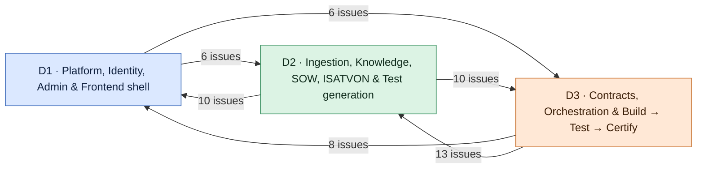
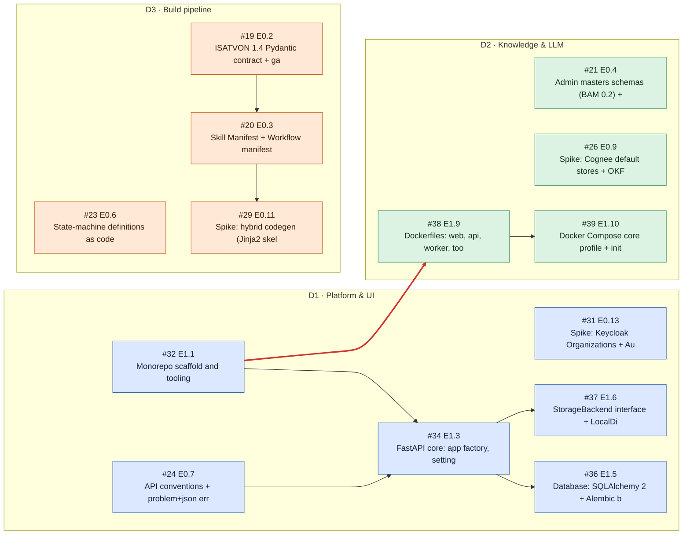
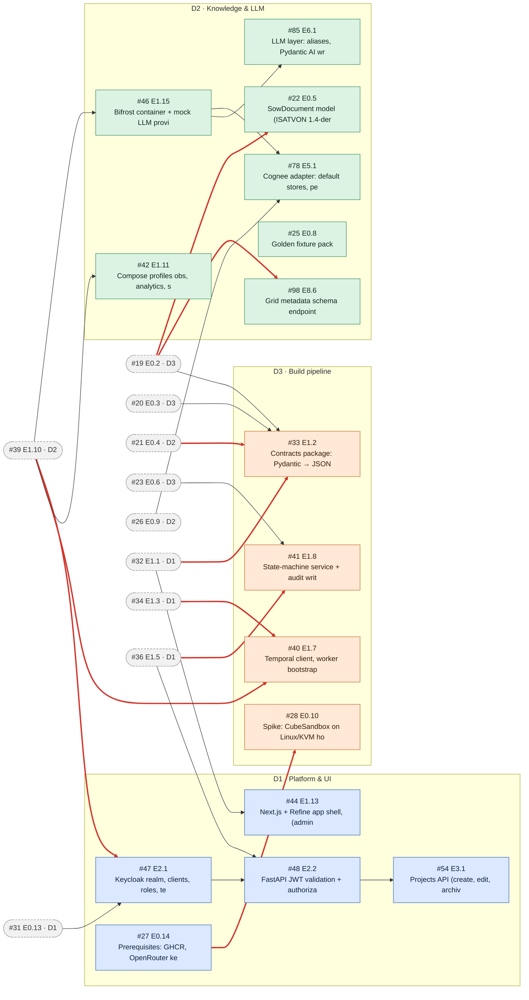
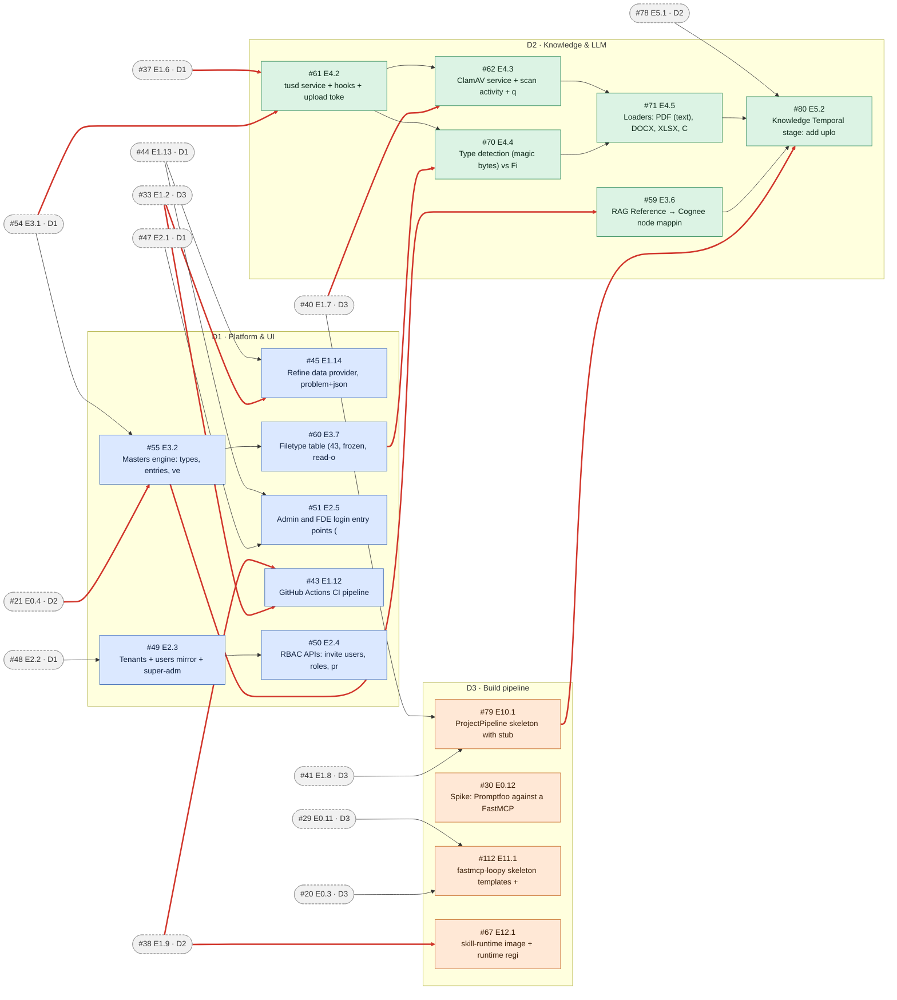
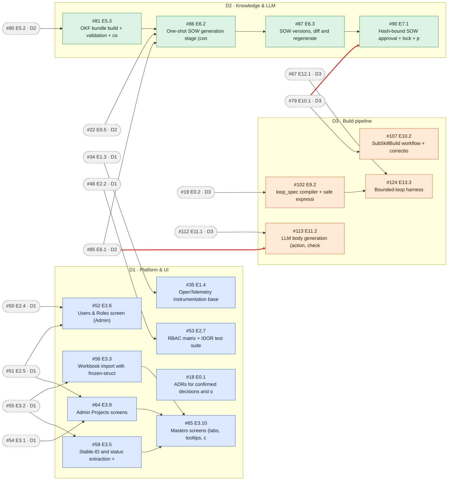
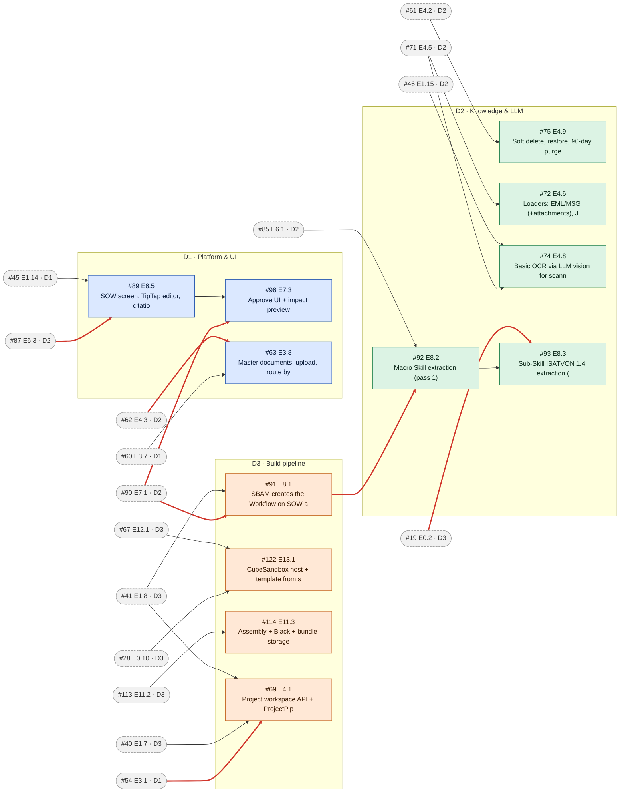
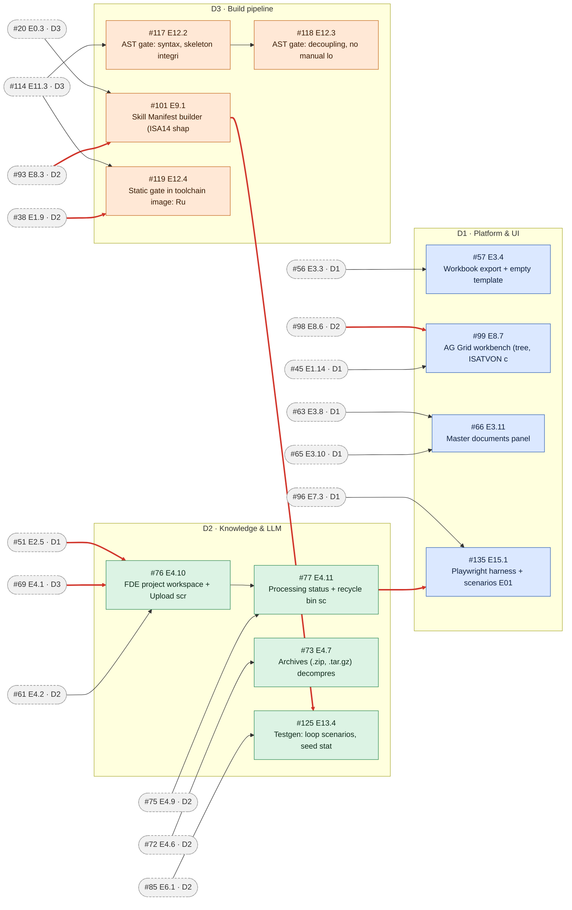
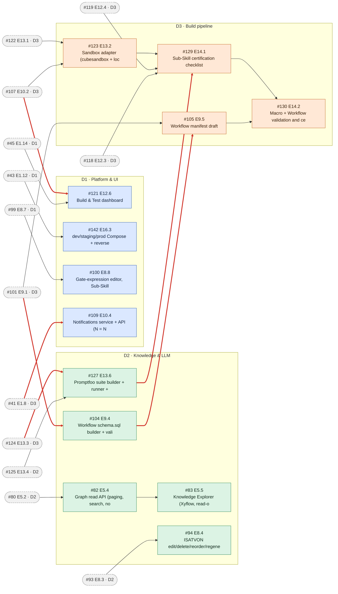
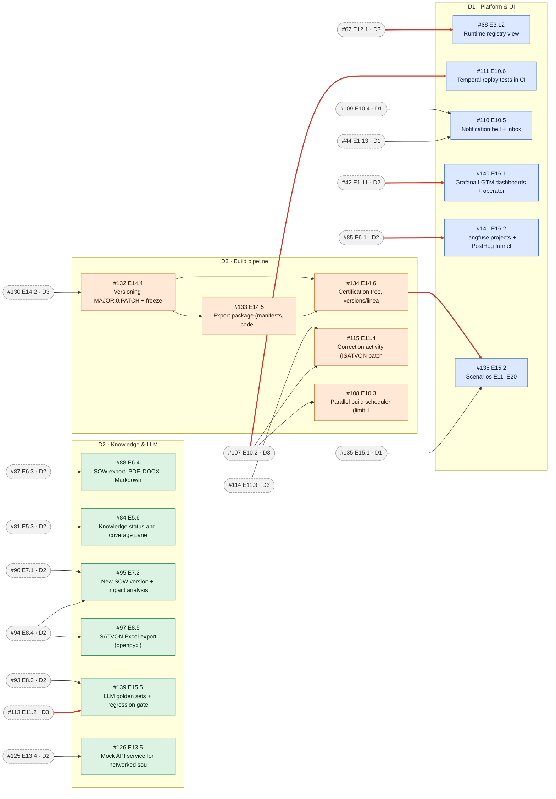
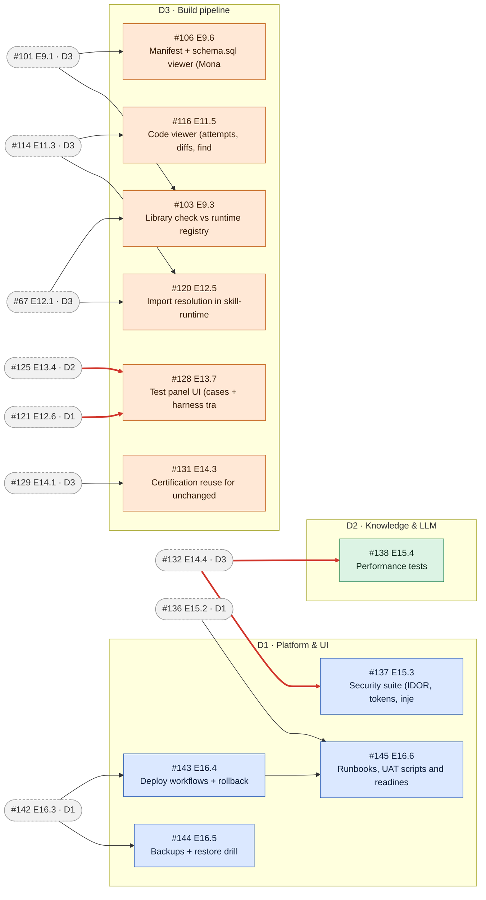

> Docs: [Home](README.md) · [Phases](phases/README.md) · [Design](design/README.md) · [Plan](plan/README.md) · [Issue map](ISSUE_MAP.md)

# Team Plan — 3 developers in parallel

This page assigns all 128 story issues to three developers and orders them into **execution waves**. Each developer owns modules end to end, which keeps conflicts low. Use it to answer three questions: *what do I work on next*, *who am I waiting for* and *who is waiting for me*.

- **Developers:** 🟦 **D1** Platform, Identity, Admin & Frontend shell · 🟩 **D2** Ingestion, Knowledge, SOW, ISATVON & Test generation · 🟧 **D3** Contracts, Orchestration & Build → Test → Certify
- **Estimated finish:** ≈ **88 dev-days** (~18 weeks) when all three work in parallel. The longest dependency chain alone is 66 dev-days. Loads: D1 88 · D2 82 · D3 88 dev-days (S = 1, M = 2.5, L = 4.5).
- **Waves** are ~10 working days (≈ 2 weeks). A wave is a planning window, not a hard gate. Start the next story as soon as its blockers are merged.
- The schedule comes from a simulation. It respects every `Blocked by` dependency, adds 0.5 day for review and merge when the blocker belongs to another developer, finishes the M0 foundation first and then follows milestone order and the critical path. Re-run `github/team/plan.py` after re-planning.

**Contents:** [A. Project understanding](#a-project-understanding) · [B. Issue table](#b-issue-dependency-table) · [C. Dependency graphs](#c-dependency-graph) · [D. Assignment](#d-developer-assignment) · [E. Waves](#e-parallel-execution-plan-waves) · [F. Conflict matrix](#f-conflict-matrix) · [G. Hotspots](#g-shared-files--hotspots) · [H. Branches](#h-recommended-branches) · [I. Merge order](#i-recommended-merge-order) · [J. Risks](#j-risks-and-recommendations) · [K. Start here](#k-start-here)

## A. Project understanding

| Aspect | Summary |
|---|---|
| Product | **SBAM**, the build-time layer of BuLLM. Admin creates a tenant project and masters. The FDE uploads documents and drives the pipeline. SBAM builds knowledge (Cognee + OKF), generates and approves the SOW, **generates the Workflow itself**, breaks it into Macro Skills and Sub-Skills (ISATVON 1.4), generates code (`fastmcp-loopy`), tests it in CubeSandbox and certifies and freezes it for SRIM. |
| Architecture | Next.js + Refine (`client/`) → FastAPI modular monolith (`server/api`) → Temporal workers (`server/workers`, ProjectPipeline + SubSkillBuild) → PostgreSQL, local disk behind an S3 interface, Keycloak, Bifrost → OpenRouter, Cognee, ClamAV, tusd, CubeSandbox. Shared Pydantic contracts in `server/contracts` generate the TypeScript types. Everything runs in Docker Compose. |
| Major modules | identity/tenancy · admin (projects, masters, filetypes) · ingestion · knowledge · LLM layer · SOW · ISATVON · manifest/schema.sql · orchestration · codegen · validation gates · sandbox/testing · certification/versioning/export · frontend · ops/observability |
| Current phase | **M0 in progress (2026-10-06).** Work merges into the `dev` branch. Merged to `dev`: #32 scaffold, #44 app shell, #24 API conventions, #26 Cognee spike, #21 masters schemas; #34 FastAPI core in review. The Docker stack (#38, #39) is not built yet: see the change notice below. |
| Key constraints | Every query is tenant-scoped (404 cross-tenant) · contracts in `server/contracts` are the single source of truth · long work runs only in Temporal activities, and workflow code is deterministic · LLM calls only through Bifrost aliases · file access only through `StorageBackend` · certified versions are immutable (423) · local-docker sandbox runs never certify · **the FDE never creates a Workflow** |

> **Change notice (2026-10-06): the Docker environment comes first.**
> The whole application must run in Docker from day one (`make up`, [TD §20](design/20-docker-and-environments.md)).
> This overrides the tables below wherever they disagree; the `Blocked by` line in each GitHub issue is authoritative.
>
> - **#38 (Dockerfiles) then #39 (Compose `core` profile)** are the next platform merges, ahead of any other issue that
>   needs a running service. They were taken over by 🟦 D1 to unblock everyone; D2 still reviews `compose/` and the Makefile.
> - #39 ships the **full `core` profile**. Services whose feature isn't built yet run as **stubs** with their final name,
>   port and healthcheck ([TD §20.3.6](design/20-docker-and-environments.md)). The owning issue later replaces only its
>   own service block: #40 workers, #46 Bifrost, #47 Keycloak realm, #61 tusd hooks, #62 ClamAV, #126 mock-api, #36 api-migrate.
> - #39 is no longer blocked by those issues (the circular dependency is removed). #36, #40, #41, #43, #45, #47, #48 and #78
>   are now blocked by #39; #35 is blocked by #42 (otel-collector).
> - Integration tests run against the same Compose stack (`make test-int`, [TD §19.3](design/19-testing-strategy.md)).
> - Redis is not an SBAM dependency; it exists only for Langfuse in the `obs` profile.

## B. Issue dependency table

Dependency class: **INDEPENDENT** = no blockers · **DEPENDENT** = blocked only by the same developer's work · **BLOCKED** = waits on another developer's issue. Conflict: 🔴 **shared-core**, which creates a file other work builds on, so merge it early · 🟡 **high**, which edits a hotspot owned by another developer · 🟢 **low**.

| Issue | Key | Feature | Phase | Module | Dev | Wave | Blocked by | Class | Conflict | Effort | Parallel |
|---|---|---|---|---|---|---|---|---|---|---|---|
| [#18](https://github.com/solutionsDigibull/BAM/issues/18) | `E0.1` | ADRs for confirmed decisions and open-item defaults | 0 | platform | 🟦 D1 | W3 | — | INDEPENDENT | 🟢 Low | S | Yes, now |
| [#19](https://github.com/solutionsDigibull/BAM/issues/19) | `E0.2` | ISATVON 1.4 Pydantic contract + gate-expression grammar | 0 | isatvon | 🟧 D3 | W0 | — | INDEPENDENT | 🔴 Shared-core | L | Yes, now |
| [#20](https://github.com/solutionsDigibull/BAM/issues/20) | `E0.3` | Skill Manifest + Workflow manifest models and RFC 8785 hashing | 0 | manifest | 🟧 D3 | W0 | [#19](https://github.com/solutionsDigibull/BAM/issues/19) (D3) | DEPENDENT | 🔴 Shared-core | M | Yes (own chain) |
| [#21](https://github.com/solutionsDigibull/BAM/issues/21) | `E0.4` | Admin masters schemas (BAM 0.2) + RAG Reference + stable-ID/status rules | 0 | admin | 🟩 D2 | W0 | — | INDEPENDENT | 🟡 High | M | Yes, now |
| [#22](https://github.com/solutionsDigibull/BAM/issues/22) | `E0.5` | SowDocument model (ISATVON 1.4-derived sections) | 0 | sow | 🟩 D2 | W1 | [#19](https://github.com/solutionsDigibull/BAM/issues/19) (D3) | BLOCKED | 🟡 High | S | After D3 |
| [#23](https://github.com/solutionsDigibull/BAM/issues/23) | `E0.6` | State-machine definitions as code (project pipeline, document, SOW, Workflow, macro, sub-skill) | 0 | orchestration | 🟧 D3 | W0 | — | INDEPENDENT | 🔴 Shared-core | S | Yes, now |
| [#24](https://github.com/solutionsDigibull/BAM/issues/24) | `E0.7` | API conventions + problem+json error schema | 0 | platform | 🟦 D1 | W0 | — | INDEPENDENT | 🟡 High | S | Yes, now |
| [#25](https://github.com/solutionsDigibull/BAM/issues/25) | `E0.8` | Golden fixture pack | 0 | testing | 🟩 D2 | W1 | — | INDEPENDENT | 🟢 Low | S | Yes, now |
| [#26](https://github.com/solutionsDigibull/BAM/issues/26) | `E0.9` | Spike: Cognee default stores + OKF bundle | 0 | knowledge | 🟩 D2 | W0 | — | INDEPENDENT | 🟢 Low | M | Yes, now |
| [#27](https://github.com/solutionsDigibull/BAM/issues/27) | `E0.14` | Prerequisites: GHCR, OpenRouter key, KVM host, dev VM, Netbird | 0 | ops | 🟦 D1 | W1 | — | INDEPENDENT | 🟢 Low | S | Yes, now |
| [#28](https://github.com/solutionsDigibull/BAM/issues/28) | `E0.10` | Spike: CubeSandbox on Linux/KVM host | 0 | sandbox | 🟧 D3 | W1 | [#27](https://github.com/solutionsDigibull/BAM/issues/27) (D1) | BLOCKED | 🟢 Low | M | After D1 |
| [#29](https://github.com/solutionsDigibull/BAM/issues/29) | `E0.11` | Spike: hybrid codegen (Jinja2 skeleton + LLM bodies) on MS01.1 | 0 | codegen | 🟧 D3 | W0 | [#20](https://github.com/solutionsDigibull/BAM/issues/20) (D3) | DEPENDENT | 🟢 Low | M | Yes (own chain) |
| [#30](https://github.com/solutionsDigibull/BAM/issues/30) | `E0.12` | Spike: Promptfoo against a FastMCP tool | 0 | sandbox | 🟧 D3 | W2 | — | INDEPENDENT | 🟢 Low | S | Yes, now |
| [#31](https://github.com/solutionsDigibull/BAM/issues/31) | `E0.13` | Spike: Keycloak Organizations + Auth.js + FastAPI JWT | 0 | identity | 🟦 D1 | W0 | — | INDEPENDENT | 🟢 Low | S | Yes, now |
| [#32](https://github.com/solutionsDigibull/BAM/issues/32) | `E1.1` | Monorepo scaffold and tooling | 1 | platform | 🟦 D1 | W0 | — | INDEPENDENT | 🔴 Shared-core | M | Yes, now |
| [#33](https://github.com/solutionsDigibull/BAM/issues/33) | `E1.2` | Contracts package: Pydantic → JSON Schema → TypeScript generation + drift check | 1 | platform | 🟧 D3 | W1 | [#32](https://github.com/solutionsDigibull/BAM/issues/32) (D1), [#19](https://github.com/solutionsDigibull/BAM/issues/19) (D3), [#20](https://github.com/solutionsDigibull/BAM/issues/20) (D3), [#21](https://github.com/solutionsDigibull/BAM/issues/21) (D2) | BLOCKED | 🔴 Shared-core | M | After D1, D2 |
| [#34](https://github.com/solutionsDigibull/BAM/issues/34) | `E1.3` | FastAPI core: app factory, settings, errors, correlation IDs, logging, health | 1 | platform | 🟦 D1 | W0 | [#32](https://github.com/solutionsDigibull/BAM/issues/32) (D1), [#24](https://github.com/solutionsDigibull/BAM/issues/24) (D1) | DEPENDENT | 🔴 Shared-core | M | Yes (own chain) |
| [#35](https://github.com/solutionsDigibull/BAM/issues/35) | `E1.4` | OpenTelemetry instrumentation baseline | 1 | observability | 🟦 D1 | W3 | [#34](https://github.com/solutionsDigibull/BAM/issues/34) (D1) | DEPENDENT | 🟢 Low | S | Yes (own chain) |
| [#36](https://github.com/solutionsDigibull/BAM/issues/36) | `E1.5` | Database: SQLAlchemy 2 + Alembic baseline + tenant-scoped repository base | 1 | platform | 🟦 D1 | W0 | [#34](https://github.com/solutionsDigibull/BAM/issues/34) (D1) | DEPENDENT | 🔴 Shared-core | M | Yes (own chain) |
| [#37](https://github.com/solutionsDigibull/BAM/issues/37) | `E1.6` | StorageBackend interface + LocalDiskBackend + S3 stub | 1 | platform | 🟦 D1 | W0 | [#34](https://github.com/solutionsDigibull/BAM/issues/34) (D1) | DEPENDENT | 🟢 Low | S | Yes (own chain) |
| [#38](https://github.com/solutionsDigibull/BAM/issues/38) | `E1.9` | Dockerfiles: web, api, worker, toolchain, promptfoo, skill-runtime base, mock-api | 1 | ops | 🟩 D2 | W0 | [#32](https://github.com/solutionsDigibull/BAM/issues/32) (D1) | BLOCKED | 🟢 Low | M | After D1 |
| [#39](https://github.com/solutionsDigibull/BAM/issues/39) | `E1.10` | Docker Compose core profile + init jobs + Makefile + README | 1 | ops | 🟩 D2 | W0 | [#38](https://github.com/solutionsDigibull/BAM/issues/38) (D2) | DEPENDENT | 🔴 Shared-core | M | Yes (own chain) |
| [#40](https://github.com/solutionsDigibull/BAM/issues/40) | `E1.7` | Temporal client, worker bootstrap (--queues), run mirror | 1 | orchestration | 🟧 D3 | W1 | [#34](https://github.com/solutionsDigibull/BAM/issues/34) (D1), [#39](https://github.com/solutionsDigibull/BAM/issues/39) (D2) | BLOCKED | 🔴 Shared-core | M | After D1, D2 |
| [#41](https://github.com/solutionsDigibull/BAM/issues/41) | `E1.8` | State-machine service + audit writer | 1 | orchestration | 🟧 D3 | W1 | [#36](https://github.com/solutionsDigibull/BAM/issues/36) (D1), [#23](https://github.com/solutionsDigibull/BAM/issues/23) (D3) | BLOCKED | 🔴 Shared-core | M | After D1 |
| [#42](https://github.com/solutionsDigibull/BAM/issues/42) | `E1.11` | Compose profiles obs, analytics, sandbox-local | 1 | ops | 🟩 D2 | W1 | [#39](https://github.com/solutionsDigibull/BAM/issues/39) (D2) | DEPENDENT | 🟢 Low | S | Yes (own chain) |
| [#43](https://github.com/solutionsDigibull/BAM/issues/43) | `E1.12` | GitHub Actions CI pipeline | 1 | ops | 🟦 D1 | W2 | [#38](https://github.com/solutionsDigibull/BAM/issues/38) (D2), [#33](https://github.com/solutionsDigibull/BAM/issues/33) (D3) | BLOCKED | 🔴 Shared-core | M | After D2, D3 |
| [#44](https://github.com/solutionsDigibull/BAM/issues/44) | `E1.13` | Next.js + Refine app shell, (admin)/(fde) route groups, UI kit | 1 | frontend | 🟦 D1 | W1 | [#32](https://github.com/solutionsDigibull/BAM/issues/32) (D1) | DEPENDENT | 🔴 Shared-core | M | Yes (own chain) |
| [#45](https://github.com/solutionsDigibull/BAM/issues/45) | `E1.14` | Refine data provider, problem+json mapping, API proxy route | 1 | frontend | 🟦 D1 | W2 | [#44](https://github.com/solutionsDigibull/BAM/issues/44) (D1), [#33](https://github.com/solutionsDigibull/BAM/issues/33) (D3) | BLOCKED | 🟢 Low | S | After D3 |
| [#46](https://github.com/solutionsDigibull/BAM/issues/46) | `E1.15` | Bifrost container + mock LLM provider for dev/tests | 1 | llm | 🟩 D2 | W1 | [#39](https://github.com/solutionsDigibull/BAM/issues/39) (D2) | DEPENDENT | 🟢 Low | S | Yes (own chain) |
| [#47](https://github.com/solutionsDigibull/BAM/issues/47) | `E2.1` | Keycloak realm, clients, roles, tenant mapper, realm export | 2 | identity | 🟦 D1 | W1 | [#39](https://github.com/solutionsDigibull/BAM/issues/39) (D2), [#31](https://github.com/solutionsDigibull/BAM/issues/31) (D1) | BLOCKED | 🟢 Low | M | After D2 |
| [#48](https://github.com/solutionsDigibull/BAM/issues/48) | `E2.2` | FastAPI JWT validation + authorization chain | 2 | identity | 🟦 D1 | W1 | [#47](https://github.com/solutionsDigibull/BAM/issues/47) (D1), [#36](https://github.com/solutionsDigibull/BAM/issues/36) (D1) | DEPENDENT | 🟢 Low | M | Yes (own chain) |
| [#49](https://github.com/solutionsDigibull/BAM/issues/49) | `E2.3` | Tenants + users mirror + super-admin tenant APIs | 2 | identity | 🟦 D1 | W2 | [#48](https://github.com/solutionsDigibull/BAM/issues/48) (D1) | DEPENDENT | 🟢 Low | S | Yes (own chain) |
| [#50](https://github.com/solutionsDigibull/BAM/issues/50) | `E2.4` | RBAC APIs: invite users, roles, project assignment | 2 | identity | 🟦 D1 | W2 | [#49](https://github.com/solutionsDigibull/BAM/issues/49) (D1) | DEPENDENT | 🟢 Low | S | Yes (own chain) |
| [#51](https://github.com/solutionsDigibull/BAM/issues/51) | `E2.5` | Admin and FDE login entry points (Auth.js Keycloak) | 2 | frontend | 🟦 D1 | W2 | [#44](https://github.com/solutionsDigibull/BAM/issues/44) (D1), [#47](https://github.com/solutionsDigibull/BAM/issues/47) (D1) | DEPENDENT | 🟢 Low | S | Yes (own chain) |
| [#52](https://github.com/solutionsDigibull/BAM/issues/52) | `E2.6` | Users & Roles screen (Admin) | 2 | frontend | 🟦 D1 | W3 | [#51](https://github.com/solutionsDigibull/BAM/issues/51) (D1), [#50](https://github.com/solutionsDigibull/BAM/issues/50) (D1) | DEPENDENT | 🟢 Low | S | Yes (own chain) |
| [#53](https://github.com/solutionsDigibull/BAM/issues/53) | `E2.7` | RBAC matrix + IDOR test suite | 2 | testing | 🟦 D1 | W3 | [#48](https://github.com/solutionsDigibull/BAM/issues/48) (D1) | DEPENDENT | 🟢 Low | S | Yes (own chain) |
| [#54](https://github.com/solutionsDigibull/BAM/issues/54) | `E3.1` | Projects API (create, edit, archive, assign FDEs, context notes) | 3 | admin | 🟦 D1 | W1 | [#48](https://github.com/solutionsDigibull/BAM/issues/48) (D1) | DEPENDENT | 🔴 Shared-core | S | Yes (own chain) |
| [#55](https://github.com/solutionsDigibull/BAM/issues/55) | `E3.2` | Masters engine: types, entries, versions, scope, snapshot | 3 | admin | 🟦 D1 | W2 | [#54](https://github.com/solutionsDigibull/BAM/issues/54) (D1), [#21](https://github.com/solutionsDigibull/BAM/issues/21) (D2) | BLOCKED | 🟢 Low | M | After D2 |
| [#56](https://github.com/solutionsDigibull/BAM/issues/56) | `E3.3` | Workbook import with frozen-structure validation | 3 | admin | 🟦 D1 | W3 | [#55](https://github.com/solutionsDigibull/BAM/issues/55) (D1) | DEPENDENT | 🟢 Low | M | Yes (own chain) |
| [#57](https://github.com/solutionsDigibull/BAM/issues/57) | `E3.4` | Workbook export + empty template | 3 | admin | 🟦 D1 | W5 | [#56](https://github.com/solutionsDigibull/BAM/issues/56) (D1) | DEPENDENT | 🟢 Low | S | Yes (own chain) |
| [#58](https://github.com/solutionsDigibull/BAM/issues/58) | `E3.5` | Stable-ID and status extraction + status write-back into Misc | 3 | admin | 🟦 D1 | W3 | [#55](https://github.com/solutionsDigibull/BAM/issues/55) (D1) | DEPENDENT | 🟢 Low | S | Yes (own chain) |
| [#59](https://github.com/solutionsDigibull/BAM/issues/59) | `E3.6` | RAG Reference → Cognee node mapping | 3 | knowledge | 🟩 D2 | W2 | [#55](https://github.com/solutionsDigibull/BAM/issues/55) (D1) | BLOCKED | 🟢 Low | S | After D1 |
| [#60](https://github.com/solutionsDigibull/BAM/issues/60) | `E3.7` | Filetype table (43, frozen, read-only) + loader/route configuration | 3 | admin | 🟦 D1 | W2 | [#55](https://github.com/solutionsDigibull/BAM/issues/55) (D1) | DEPENDENT | 🟢 Low | S | Yes (own chain) |
| [#61](https://github.com/solutionsDigibull/BAM/issues/61) | `E4.2` | tusd service + hooks + upload token + limits | 4 | ingestion | 🟩 D2 | W2 | [#37](https://github.com/solutionsDigibull/BAM/issues/37) (D1), [#54](https://github.com/solutionsDigibull/BAM/issues/54) (D1) | BLOCKED | 🟡 High | M | After D1, D1 |
| [#62](https://github.com/solutionsDigibull/BAM/issues/62) | `E4.3` | ClamAV service + scan activity + quarantine | 4 | ingestion | 🟩 D2 | W2 | [#61](https://github.com/solutionsDigibull/BAM/issues/61) (D2), [#40](https://github.com/solutionsDigibull/BAM/issues/40) (D3) | BLOCKED | 🔴 Shared-core | S | After D3 |
| [#63](https://github.com/solutionsDigibull/BAM/issues/63) | `E3.8` | Master documents: upload, route by filetype, admin override | 3 | admin | 🟦 D1 | W4 | [#60](https://github.com/solutionsDigibull/BAM/issues/60) (D1), [#62](https://github.com/solutionsDigibull/BAM/issues/62) (D2) | BLOCKED | 🟢 Low | M | After D2 |
| [#64](https://github.com/solutionsDigibull/BAM/issues/64) | `E3.9` | Admin Projects screens | 3 | frontend | 🟦 D1 | W3 | [#51](https://github.com/solutionsDigibull/BAM/issues/51) (D1), [#54](https://github.com/solutionsDigibull/BAM/issues/54) (D1) | DEPENDENT | 🟢 Low | S | Yes (own chain) |
| [#65](https://github.com/solutionsDigibull/BAM/issues/65) | `E3.10` | Masters screens (tabs, tooltips, chips, RAG editor, import/export wizard) | 3 | frontend | 🟦 D1 | W3 | [#56](https://github.com/solutionsDigibull/BAM/issues/56) (D1), [#58](https://github.com/solutionsDigibull/BAM/issues/58) (D1), [#64](https://github.com/solutionsDigibull/BAM/issues/64) (D1) | DEPENDENT | 🟢 Low | L | Yes (own chain) |
| [#66](https://github.com/solutionsDigibull/BAM/issues/66) | `E3.11` | Master documents panel | 3 | frontend | 🟦 D1 | W5 | [#63](https://github.com/solutionsDigibull/BAM/issues/63) (D1), [#65](https://github.com/solutionsDigibull/BAM/issues/65) (D1) | DEPENDENT | 🟢 Low | S | Yes (own chain) |
| [#67](https://github.com/solutionsDigibull/BAM/issues/67) | `E12.1` | skill-runtime image + runtime registry generation | 12 | sandbox | 🟧 D3 | W2 | [#38](https://github.com/solutionsDigibull/BAM/issues/38) (D2) | BLOCKED | 🟢 Low | M | After D2 |
| [#68](https://github.com/solutionsDigibull/BAM/issues/68) | `E3.12` | Runtime registry view | 3 | frontend | 🟦 D1 | W7 | [#67](https://github.com/solutionsDigibull/BAM/issues/67) (D3) | BLOCKED | 🟢 Low | S | After D3 |
| [#69](https://github.com/solutionsDigibull/BAM/issues/69) | `E4.1` | Project workspace API + ProjectPipeline start + dashboard | 4 | orchestration | 🟧 D3 | W4 | [#54](https://github.com/solutionsDigibull/BAM/issues/54) (D1), [#40](https://github.com/solutionsDigibull/BAM/issues/40) (D3), [#41](https://github.com/solutionsDigibull/BAM/issues/41) (D3) | BLOCKED | 🟡 High | M | After D1 |
| [#70](https://github.com/solutionsDigibull/BAM/issues/70) | `E4.4` | Type detection (magic bytes) vs Filetype config + SHA-256 dedupe | 4 | ingestion | 🟩 D2 | W2 | [#61](https://github.com/solutionsDigibull/BAM/issues/61) (D2), [#60](https://github.com/solutionsDigibull/BAM/issues/60) (D1) | BLOCKED | 🟢 Low | S | After D1 |
| [#71](https://github.com/solutionsDigibull/BAM/issues/71) | `E4.5` | Loaders: PDF (text), DOCX, XLSX, CSV, MD, TXT | 4 | ingestion | 🟩 D2 | W2 | [#62](https://github.com/solutionsDigibull/BAM/issues/62) (D2), [#70](https://github.com/solutionsDigibull/BAM/issues/70) (D2) | DEPENDENT | 🟡 High | M | Yes (own chain) |
| [#72](https://github.com/solutionsDigibull/BAM/issues/72) | `E4.6` | Loaders: EML/MSG (+attachments), JSON/XML/YAML/OpenAPI/Swagger/FastMCP spec, source code | 4 | ingestion | 🟩 D2 | W4 | [#71](https://github.com/solutionsDigibull/BAM/issues/71) (D2) | DEPENDENT | 🟢 Low | M | Yes (own chain) |
| [#73](https://github.com/solutionsDigibull/BAM/issues/73) | `E4.7` | Archives (.zip, .tar.gz) decompressed into member documents | 4 | ingestion | 🟩 D2 | W5 | [#72](https://github.com/solutionsDigibull/BAM/issues/72) (D2) | DEPENDENT | 🟢 Low | S | Yes (own chain) |
| [#74](https://github.com/solutionsDigibull/BAM/issues/74) | `E4.8` | Basic OCR via LLM vision for scanned PDF and images | 4 | ingestion | 🟩 D2 | W4 | [#71](https://github.com/solutionsDigibull/BAM/issues/71) (D2), [#46](https://github.com/solutionsDigibull/BAM/issues/46) (D2) | DEPENDENT | 🟢 Low | M | Yes (own chain) |
| [#75](https://github.com/solutionsDigibull/BAM/issues/75) | `E4.9` | Soft delete, restore, 90-day purge schedule | 4 | ingestion | 🟩 D2 | W4 | [#61](https://github.com/solutionsDigibull/BAM/issues/61) (D2) | DEPENDENT | 🟡 High | S | Yes (own chain) |
| [#76](https://github.com/solutionsDigibull/BAM/issues/76) | `E4.10` | FDE project workspace + Upload screen (Uppy) | 4 | frontend | 🟩 D2 | W5 | [#51](https://github.com/solutionsDigibull/BAM/issues/51) (D1), [#69](https://github.com/solutionsDigibull/BAM/issues/69) (D3), [#61](https://github.com/solutionsDigibull/BAM/issues/61) (D2) | BLOCKED | 🟡 High | M | After D1, D3 |
| [#77](https://github.com/solutionsDigibull/BAM/issues/77) | `E4.11` | Processing status + recycle bin screen | 4 | frontend | 🟩 D2 | W5 | [#76](https://github.com/solutionsDigibull/BAM/issues/76) (D2), [#75](https://github.com/solutionsDigibull/BAM/issues/75) (D2) | DEPENDENT | 🟢 Low | S | Yes (own chain) |
| [#78](https://github.com/solutionsDigibull/BAM/issues/78) | `E5.1` | Cognee adapter: default stores, per-project dataset, Bifrost routing | 5 | knowledge | 🟩 D2 | W1 | [#26](https://github.com/solutionsDigibull/BAM/issues/26) (D2), [#46](https://github.com/solutionsDigibull/BAM/issues/46) (D2) | DEPENDENT | 🟢 Low | M | Yes (own chain) |
| [#79](https://github.com/solutionsDigibull/BAM/issues/79) | `E10.1` | ProjectPipeline skeleton with stub activities, signals and waits | 10 | orchestration | 🟧 D3 | W2 | [#40](https://github.com/solutionsDigibull/BAM/issues/40) (D3), [#41](https://github.com/solutionsDigibull/BAM/issues/41) (D3) | DEPENDENT | 🔴 Shared-core | M | Yes (own chain) |
| [#80](https://github.com/solutionsDigibull/BAM/issues/80) | `E5.2` | Knowledge Temporal stage: add uploads + master snapshot, cognify | 5 | knowledge | 🟩 D2 | W2 | [#78](https://github.com/solutionsDigibull/BAM/issues/78) (D2), [#71](https://github.com/solutionsDigibull/BAM/issues/71) (D2), [#59](https://github.com/solutionsDigibull/BAM/issues/59) (D2), [#79](https://github.com/solutionsDigibull/BAM/issues/79) (D3) | BLOCKED | 🟡 High | M | After D3 |
| [#81](https://github.com/solutionsDigibull/BAM/issues/81) | `E5.3` | OKF bundle build + validation + coverage | 5 | knowledge | 🟩 D2 | W3 | [#80](https://github.com/solutionsDigibull/BAM/issues/80) (D2) | DEPENDENT | 🟢 Low | M | Yes (own chain) |
| [#82](https://github.com/solutionsDigibull/BAM/issues/82) | `E5.4` | Graph read API (paging, search, node detail with sources) | 5 | knowledge | 🟩 D2 | W6 | [#80](https://github.com/solutionsDigibull/BAM/issues/80) (D2) | DEPENDENT | 🟢 Low | S | Yes (own chain) |
| [#83](https://github.com/solutionsDigibull/BAM/issues/83) | `E5.5` | Knowledge Explorer (Xyflow, read-only) | 5 | frontend | 🟩 D2 | W6 | [#82](https://github.com/solutionsDigibull/BAM/issues/82) (D2) | DEPENDENT | 🟡 High | M | Yes (own chain) |
| [#84](https://github.com/solutionsDigibull/BAM/issues/84) | `E5.6` | Knowledge status and coverage panel | 5 | frontend | 🟩 D2 | W7 | [#81](https://github.com/solutionsDigibull/BAM/issues/81) (D2) | DEPENDENT | 🟢 Low | S | Yes (own chain) |
| [#85](https://github.com/solutionsDigibull/BAM/issues/85) | `E6.1` | LLM layer: aliases, Pydantic AI wrapper, prompt registry, llm_calls, Langfuse | 6 | llm | 🟩 D2 | W1 | [#46](https://github.com/solutionsDigibull/BAM/issues/46) (D2) | DEPENDENT | 🟡 High | M | Yes (own chain) |
| [#86](https://github.com/solutionsDigibull/BAM/issues/86) | `E6.2` | One-shot SOW generation stage (context assembly, re-ask, citations) | 6 | sow | 🟩 D2 | W3 | [#85](https://github.com/solutionsDigibull/BAM/issues/85) (D2), [#81](https://github.com/solutionsDigibull/BAM/issues/81) (D2), [#22](https://github.com/solutionsDigibull/BAM/issues/22) (D2) | DEPENDENT | 🟡 High | L | Yes (own chain) |
| [#87](https://github.com/solutionsDigibull/BAM/issues/87) | `E6.3` | SOW versions, diff and regenerate APIs | 6 | sow | 🟩 D2 | W3 | [#86](https://github.com/solutionsDigibull/BAM/issues/86) (D2) | DEPENDENT | 🟡 High | S | Yes (own chain) |
| [#88](https://github.com/solutionsDigibull/BAM/issues/88) | `E6.4` | SOW export: PDF, DOCX, Markdown | 6 | sow | 🟩 D2 | W7 | [#87](https://github.com/solutionsDigibull/BAM/issues/87) (D2) | DEPENDENT | 🟢 Low | S | Yes (own chain) |
| [#89](https://github.com/solutionsDigibull/BAM/issues/89) | `E6.5` | SOW screen: TipTap editor, citations panel, versions/diff | 6 | frontend | 🟦 D1 | W4 | [#87](https://github.com/solutionsDigibull/BAM/issues/87) (D2), [#45](https://github.com/solutionsDigibull/BAM/issues/45) (D1) | BLOCKED | 🟢 Low | L | After D2 |
| [#90](https://github.com/solutionsDigibull/BAM/issues/90) | `E7.1` | Hash-bound SOW approval + lock + pipeline signal | 7 | sow | 🟩 D2 | W3 | [#87](https://github.com/solutionsDigibull/BAM/issues/87) (D2), [#79](https://github.com/solutionsDigibull/BAM/issues/79) (D3) | BLOCKED | 🟡 High | S | After D3 |
| [#91](https://github.com/solutionsDigibull/BAM/issues/91) | `E8.1` | SBAM creates the Workflow on SOW approval | 8 | orchestration | 🟧 D3 | W4 | [#90](https://github.com/solutionsDigibull/BAM/issues/90) (D2), [#41](https://github.com/solutionsDigibull/BAM/issues/41) (D3) | BLOCKED | 🟡 High | S | After D2 |
| [#92](https://github.com/solutionsDigibull/BAM/issues/92) | `E8.2` | Macro Skill extraction (pass 1) | 8 | isatvon | 🟩 D2 | W4 | [#91](https://github.com/solutionsDigibull/BAM/issues/91) (D3), [#85](https://github.com/solutionsDigibull/BAM/issues/85) (D2) | BLOCKED | 🟡 High | M | After D3 |
| [#93](https://github.com/solutionsDigibull/BAM/issues/93) | `E8.3` | Sub-Skill ISATVON 1.4 extraction (pass 2) + validation | 8 | isatvon | 🟩 D2 | W4 | [#92](https://github.com/solutionsDigibull/BAM/issues/92) (D2), [#19](https://github.com/solutionsDigibull/BAM/issues/19) (D3) | BLOCKED | 🟡 High | L | After D3 |
| [#94](https://github.com/solutionsDigibull/BAM/issues/94) | `E8.4` | ISATVON edit/delete/reorder/regenerate APIs + field audit | 8 | isatvon | 🟩 D2 | W6 | [#93](https://github.com/solutionsDigibull/BAM/issues/93) (D2) | DEPENDENT | 🟡 High | M | Yes (own chain) |
| [#95](https://github.com/solutionsDigibull/BAM/issues/95) | `E7.2` | New SOW version + impact analysis + selective invalidation | 7 | sow | 🟩 D2 | W7 | [#90](https://github.com/solutionsDigibull/BAM/issues/90) (D2), [#94](https://github.com/solutionsDigibull/BAM/issues/94) (D2) | DEPENDENT | 🟡 High | M | Yes (own chain) |
| [#96](https://github.com/solutionsDigibull/BAM/issues/96) | `E7.3` | Approve UI + impact preview | 7 | frontend | 🟦 D1 | W4 | [#90](https://github.com/solutionsDigibull/BAM/issues/90) (D2), [#89](https://github.com/solutionsDigibull/BAM/issues/89) (D1) | BLOCKED | 🟢 Low | S | After D2 |
| [#97](https://github.com/solutionsDigibull/BAM/issues/97) | `E8.5` | ISATVON Excel export (openpyxl) | 8 | isatvon | 🟩 D2 | W7 | [#94](https://github.com/solutionsDigibull/BAM/issues/94) (D2) | DEPENDENT | 🟢 Low | S | Yes (own chain) |
| [#98](https://github.com/solutionsDigibull/BAM/issues/98) | `E8.6` | Grid metadata schema endpoint | 8 | isatvon | 🟩 D2 | W1 | [#19](https://github.com/solutionsDigibull/BAM/issues/19) (D3) | BLOCKED | 🟢 Low | S | After D3 |
| [#99](https://github.com/solutionsDigibull/BAM/issues/99) | `E8.7` | AG Grid workbench (tree, ISATVON column groups, editors, safeguards) | 8 | frontend | 🟦 D1 | W5 | [#98](https://github.com/solutionsDigibull/BAM/issues/98) (D2), [#45](https://github.com/solutionsDigibull/BAM/issues/45) (D1) | BLOCKED | 🟢 Low | L | After D2 |
| [#100](https://github.com/solutionsDigibull/BAM/issues/100) | `E8.8` | Gate-expression editor, Sub-Skill drawer, I/O dependency view | 8 | frontend | 🟦 D1 | W6 | [#99](https://github.com/solutionsDigibull/BAM/issues/99) (D1) | DEPENDENT | 🟢 Low | M | Yes (own chain) |
| [#101](https://github.com/solutionsDigibull/BAM/issues/101) | `E9.1` | Skill Manifest builder (ISA14 shape + sbam_build_record) | 9 | manifest | 🟧 D3 | W5 | [#20](https://github.com/solutionsDigibull/BAM/issues/20) (D3), [#93](https://github.com/solutionsDigibull/BAM/issues/93) (D2) | BLOCKED | 🔴 Shared-core | M | After D2 |
| [#102](https://github.com/solutionsDigibull/BAM/issues/102) | `E9.2` | loop_spec compiler + safe expression evaluator | 9 | manifest | 🟧 D3 | W3 | [#19](https://github.com/solutionsDigibull/BAM/issues/19) (D3) | DEPENDENT | 🟢 Low | M | Yes (own chain) |
| [#103](https://github.com/solutionsDigibull/BAM/issues/103) | `E9.3` | Library check vs runtime registry | 9 | manifest | 🟧 D3 | W8 | [#101](https://github.com/solutionsDigibull/BAM/issues/101) (D3), [#67](https://github.com/solutionsDigibull/BAM/issues/67) (D3) | DEPENDENT | 🟢 Low | S | Yes (own chain) |
| [#104](https://github.com/solutionsDigibull/BAM/issues/104) | `E9.4` | Workflow schema.sql builder + validation | 9 | manifest | 🟩 D2 | W6 | [#101](https://github.com/solutionsDigibull/BAM/issues/101) (D3) | BLOCKED | 🟡 High | M | After D3 |
| [#105](https://github.com/solutionsDigibull/BAM/issues/105) | `E9.5` | Workflow manifest draft | 9 | manifest | 🟧 D3 | W6 | [#101](https://github.com/solutionsDigibull/BAM/issues/101) (D3), [#104](https://github.com/solutionsDigibull/BAM/issues/104) (D2) | BLOCKED | 🟢 Low | S | After D2 |
| [#106](https://github.com/solutionsDigibull/BAM/issues/106) | `E9.6` | Manifest + schema.sql viewer (Monaco) | 9 | frontend | 🟧 D3 | W8 | [#101](https://github.com/solutionsDigibull/BAM/issues/101) (D3) | DEPENDENT | 🟢 Low | S | Yes (own chain) |
| [#107](https://github.com/solutionsDigibull/BAM/issues/107) | `E10.2` | SubSkillBuild workflow + correction loop (≤2) + retry signal | 10 | orchestration | 🟧 D3 | W3 | [#79](https://github.com/solutionsDigibull/BAM/issues/79) (D3) | DEPENDENT | 🟢 Low | M | Yes (own chain) |
| [#108](https://github.com/solutionsDigibull/BAM/issues/108) | `E10.3` | Parallel build scheduler (limit, I/O ordering) | 10 | orchestration | 🟧 D3 | W7 | [#107](https://github.com/solutionsDigibull/BAM/issues/107) (D3) | DEPENDENT | 🟢 Low | S | Yes (own chain) |
| [#109](https://github.com/solutionsDigibull/BAM/issues/109) | `E10.4` | Notifications service + API (N = Next/Notification) | 10 | orchestration | 🟦 D1 | W6 | [#41](https://github.com/solutionsDigibull/BAM/issues/41) (D3) | BLOCKED | 🟢 Low | S | After D3 |
| [#110](https://github.com/solutionsDigibull/BAM/issues/110) | `E10.5` | Notification bell + inbox | 10 | frontend | 🟦 D1 | W7 | [#109](https://github.com/solutionsDigibull/BAM/issues/109) (D1), [#44](https://github.com/solutionsDigibull/BAM/issues/44) (D1) | DEPENDENT | 🟢 Low | S | Yes (own chain) |
| [#111](https://github.com/solutionsDigibull/BAM/issues/111) | `E10.6` | Temporal replay tests in CI | 10 | testing | 🟦 D1 | W7 | [#107](https://github.com/solutionsDigibull/BAM/issues/107) (D3) | BLOCKED | 🟢 Low | S | After D3 |
| [#112](https://github.com/solutionsDigibull/BAM/issues/112) | `E11.1` | fastmcp-loopy skeleton templates + golden snapshots | 11 | codegen | 🟧 D3 | W2 | [#29](https://github.com/solutionsDigibull/BAM/issues/29) (D3), [#20](https://github.com/solutionsDigibull/BAM/issues/20) (D3) | DEPENDENT | 🟢 Low | L | Yes (own chain) |
| [#113](https://github.com/solutionsDigibull/BAM/issues/113) | `E11.2` | LLM body generation (action, check, state queries) | 11 | codegen | 🟧 D3 | W3 | [#112](https://github.com/solutionsDigibull/BAM/issues/112) (D3), [#85](https://github.com/solutionsDigibull/BAM/issues/85) (D2) | BLOCKED | 🟢 Low | M | After D2 |
| [#114](https://github.com/solutionsDigibull/BAM/issues/114) | `E11.3` | Assembly + Black + bundle storage | 11 | codegen | 🟧 D3 | W4 | [#113](https://github.com/solutionsDigibull/BAM/issues/113) (D3) | DEPENDENT | 🟡 High | S | Yes (own chain) |
| [#115](https://github.com/solutionsDigibull/BAM/issues/115) | `E11.4` | Correction activity (ISATVON patch + Python edit, max 2) | 11 | codegen | 🟧 D3 | W7 | [#114](https://github.com/solutionsDigibull/BAM/issues/114) (D3), [#107](https://github.com/solutionsDigibull/BAM/issues/107) (D3) | DEPENDENT | 🟢 Low | M | Yes (own chain) |
| [#116](https://github.com/solutionsDigibull/BAM/issues/116) | `E11.5` | Code viewer (attempts, diffs, findings markers) | 11 | frontend | 🟧 D3 | W8 | [#114](https://github.com/solutionsDigibull/BAM/issues/114) (D3) | DEPENDENT | 🟢 Low | S | Yes (own chain) |
| [#117](https://github.com/solutionsDigibull/BAM/issues/117) | `E12.2` | AST gate: syntax, skeleton integrity, manifest conformance | 12 | validation | 🟧 D3 | W5 | [#114](https://github.com/solutionsDigibull/BAM/issues/114) (D3) | DEPENDENT | 🟢 Low | M | Yes (own chain) |
| [#118](https://github.com/solutionsDigibull/BAM/issues/118) | `E12.3` | AST gate: decoupling, no manual loops, handoff, imports, SQL safety | 12 | validation | 🟧 D3 | W5 | [#117](https://github.com/solutionsDigibull/BAM/issues/117) (D3) | DEPENDENT | 🟢 Low | M | Yes (own chain) |
| [#119](https://github.com/solutionsDigibull/BAM/issues/119) | `E12.4` | Static gate in toolchain image: Ruff, Black, MyPy strict, Bandit, ClamAV | 12 | validation | 🟧 D3 | W5 | [#114](https://github.com/solutionsDigibull/BAM/issues/114) (D3), [#38](https://github.com/solutionsDigibull/BAM/issues/38) (D2) | BLOCKED | 🟢 Low | M | After D2 |
| [#120](https://github.com/solutionsDigibull/BAM/issues/120) | `E12.5` | Import resolution in skill-runtime | 12 | validation | 🟧 D3 | W8 | [#67](https://github.com/solutionsDigibull/BAM/issues/67) (D3), [#114](https://github.com/solutionsDigibull/BAM/issues/114) (D3) | DEPENDENT | 🟢 Low | S | Yes (own chain) |
| [#121](https://github.com/solutionsDigibull/BAM/issues/121) | `E12.6` | Build & Test dashboard | 12 | frontend | 🟦 D1 | W6 | [#107](https://github.com/solutionsDigibull/BAM/issues/107) (D3), [#45](https://github.com/solutionsDigibull/BAM/issues/45) (D1) | BLOCKED | 🟢 Low | M | After D3 |
| [#122](https://github.com/solutionsDigibull/BAM/issues/122) | `E13.1` | CubeSandbox host + template from skill-runtime + Netbird | 13 | sandbox | 🟧 D3 | W4 | [#28](https://github.com/solutionsDigibull/BAM/issues/28) (D3), [#67](https://github.com/solutionsDigibull/BAM/issues/67) (D3) | DEPENDENT | 🟢 Low | L | Yes (own chain) |
| [#123](https://github.com/solutionsDigibull/BAM/issues/123) | `E13.2` | Sandbox adapter (cubesandbox + local-docker non-certifying) | 13 | sandbox | 🟧 D3 | W6 | [#122](https://github.com/solutionsDigibull/BAM/issues/122) (D3), [#107](https://github.com/solutionsDigibull/BAM/issues/107) (D3) | DEPENDENT | 🟢 Low | M | Yes (own chain) |
| [#124](https://github.com/solutionsDigibull/BAM/issues/124) | `E13.3` | Bounded-loop harness | 13 | sandbox | 🟧 D3 | W3 | [#102](https://github.com/solutionsDigibull/BAM/issues/102) (D3), [#67](https://github.com/solutionsDigibull/BAM/issues/67) (D3) | DEPENDENT | 🟢 Low | L | Yes (own chain) |
| [#125](https://github.com/solutionsDigibull/BAM/issues/125) | `E13.4` | Testgen: loop scenarios, seed state, state scripts, files | 13 | sandbox | 🟩 D2 | W5 | [#101](https://github.com/solutionsDigibull/BAM/issues/101) (D3), [#85](https://github.com/solutionsDigibull/BAM/issues/85) (D2) | BLOCKED | 🟡 High | M | After D3 |
| [#126](https://github.com/solutionsDigibull/BAM/issues/126) | `E13.5` | Mock API service for networked sources | 13 | sandbox | 🟩 D2 | W7 | [#125](https://github.com/solutionsDigibull/BAM/issues/125) (D2) | DEPENDENT | 🟢 Low | S | Yes (own chain) |
| [#127](https://github.com/solutionsDigibull/BAM/issues/127) | `E13.6` | Promptfoo suite builder + runner + grid badges | 13 | sandbox | 🟩 D2 | W6 | [#124](https://github.com/solutionsDigibull/BAM/issues/124) (D3), [#125](https://github.com/solutionsDigibull/BAM/issues/125) (D2) | BLOCKED | 🟢 Low | M | After D3 |
| [#128](https://github.com/solutionsDigibull/BAM/issues/128) | `E13.7` | Test panel UI (cases + harness trace) | 13 | frontend | 🟧 D3 | W8 | [#125](https://github.com/solutionsDigibull/BAM/issues/125) (D2), [#121](https://github.com/solutionsDigibull/BAM/issues/121) (D1) | BLOCKED | 🟢 Low | M | After D2, D1 |
| [#129](https://github.com/solutionsDigibull/BAM/issues/129) | `E14.1` | Sub-Skill certification checklist + manifest APPROVED | 14 | certification | 🟧 D3 | W6 | [#127](https://github.com/solutionsDigibull/BAM/issues/127) (D2), [#123](https://github.com/solutionsDigibull/BAM/issues/123) (D3), [#119](https://github.com/solutionsDigibull/BAM/issues/119) (D3), [#118](https://github.com/solutionsDigibull/BAM/issues/118) (D3) | BLOCKED | 🟡 High | M | After D2 |
| [#130](https://github.com/solutionsDigibull/BAM/issues/130) | `E14.2` | Macro + Workflow validation and certification | 14 | certification | 🟧 D3 | W6 | [#129](https://github.com/solutionsDigibull/BAM/issues/129) (D3), [#105](https://github.com/solutionsDigibull/BAM/issues/105) (D3) | DEPENDENT | 🟢 Low | M | Yes (own chain) |
| [#131](https://github.com/solutionsDigibull/BAM/issues/131) | `E14.3` | Certification reuse for unchanged Sub-Skills | 14 | certification | 🟧 D3 | W8 | [#129](https://github.com/solutionsDigibull/BAM/issues/129) (D3) | DEPENDENT | 🟢 Low | S | Yes (own chain) |
| [#132](https://github.com/solutionsDigibull/BAM/issues/132) | `E14.4` | Versioning MAJOR.0.PATCH + freeze + immutability triggers | 14 | certification | 🟧 D3 | W7 | [#130](https://github.com/solutionsDigibull/BAM/issues/130) (D3) | DEPENDENT | 🟡 High | M | Yes (own chain) |
| [#133](https://github.com/solutionsDigibull/BAM/issues/133) | `E14.5` | Export package (manifests, code, loop specs, schema.sql, evidence, checksums) | 14 | certification | 🟧 D3 | W7 | [#132](https://github.com/solutionsDigibull/BAM/issues/132) (D3) | DEPENDENT | 🟢 Low | S | Yes (own chain) |
| [#134](https://github.com/solutionsDigibull/BAM/issues/134) | `E14.6` | Certification tree, versions/lineage and export UI | 14 | frontend | 🟧 D3 | W7 | [#132](https://github.com/solutionsDigibull/BAM/issues/132) (D3), [#133](https://github.com/solutionsDigibull/BAM/issues/133) (D3) | DEPENDENT | 🟢 Low | M | Yes (own chain) |
| [#135](https://github.com/solutionsDigibull/BAM/issues/135) | `E15.1` | Playwright harness + scenarios E01–E10 | 15 | testing | 🟦 D1 | W5 | [#96](https://github.com/solutionsDigibull/BAM/issues/96) (D1), [#77](https://github.com/solutionsDigibull/BAM/issues/77) (D2) | BLOCKED | 🟢 Low | L | After D2 |
| [#136](https://github.com/solutionsDigibull/BAM/issues/136) | `E15.2` | Scenarios E11–E20 | 15 | testing | 🟦 D1 | W7 | [#134](https://github.com/solutionsDigibull/BAM/issues/134) (D3), [#135](https://github.com/solutionsDigibull/BAM/issues/135) (D1) | BLOCKED | 🟢 Low | L | After D3 |
| [#137](https://github.com/solutionsDigibull/BAM/issues/137) | `E15.3` | Security suite (IDOR, tokens, injection, tamper, egress, scans) | 15 | testing | 🟦 D1 | W8 | [#132](https://github.com/solutionsDigibull/BAM/issues/132) (D3) | BLOCKED | 🟢 Low | M | After D3 |
| [#138](https://github.com/solutionsDigibull/BAM/issues/138) | `E15.4` | Performance tests | 15 | testing | 🟩 D2 | W8 | [#132](https://github.com/solutionsDigibull/BAM/issues/132) (D3) | BLOCKED | 🟢 Low | M | After D3 |
| [#139](https://github.com/solutionsDigibull/BAM/issues/139) | `E15.5` | LLM golden sets + regression gate | 15 | testing | 🟩 D2 | W7 | [#93](https://github.com/solutionsDigibull/BAM/issues/93) (D2), [#113](https://github.com/solutionsDigibull/BAM/issues/113) (D3) | BLOCKED | 🟢 Low | M | After D3 |
| [#140](https://github.com/solutionsDigibull/BAM/issues/140) | `E16.1` | Grafana LGTM dashboards + operator alerts | 16 | observability | 🟦 D1 | W7 | [#42](https://github.com/solutionsDigibull/BAM/issues/42) (D2) | BLOCKED | 🟢 Low | M | After D2 |
| [#141](https://github.com/solutionsDigibull/BAM/issues/141) | `E16.2` | Langfuse projects + PostHog funnel/eval events | 16 | observability | 🟦 D1 | W7 | [#85](https://github.com/solutionsDigibull/BAM/issues/85) (D2) | BLOCKED | 🟢 Low | S | After D2 |
| [#142](https://github.com/solutionsDigibull/BAM/issues/142) | `E16.3` | dev/staging/prod Compose + reverse proxy + Netbird policies | 16 | ops | 🟦 D1 | W6 | [#43](https://github.com/solutionsDigibull/BAM/issues/43) (D1) | DEPENDENT | 🟢 Low | M | Yes (own chain) |
| [#143](https://github.com/solutionsDigibull/BAM/issues/143) | `E16.4` | Deploy workflows + rollback | 16 | ops | 🟦 D1 | W8 | [#142](https://github.com/solutionsDigibull/BAM/issues/142) (D1) | DEPENDENT | 🟢 Low | S | Yes (own chain) |
| [#144](https://github.com/solutionsDigibull/BAM/issues/144) | `E16.5` | Backups + restore drill | 16 | ops | 🟦 D1 | W8 | [#142](https://github.com/solutionsDigibull/BAM/issues/142) (D1) | DEPENDENT | 🟢 Low | S | Yes (own chain) |
| [#145](https://github.com/solutionsDigibull/BAM/issues/145) | `E16.6` | Runbooks, UAT scripts and readiness review | 16 | ops | 🟦 D1 | W8 | [#136](https://github.com/solutionsDigibull/BAM/issues/136) (D1), [#143](https://github.com/solutionsDigibull/BAM/issues/143) (D1) | DEPENDENT | 🟢 Low | M | Yes (own chain) |

## C. Dependency graph

The interactive version (click an issue to light up its whole upstream and downstream chain) is linked from the PR or kept by the team lead. GitHub renders the Mermaid graphs below. Colours: 🟦 D1 · 🟩 D2 · 🟧 D3. **Thick red arrows are hand-offs between developers**, which are the points where someone can get blocked.

### C.1 Who waits for whom



| From → To | Hand-offs (blocker → blocked) |
|---|---|
| D1 → D2 | [#32](https://github.com/solutionsDigibull/BAM/issues/32)→[#38](https://github.com/solutionsDigibull/BAM/issues/38), [#37](https://github.com/solutionsDigibull/BAM/issues/37)→[#61](https://github.com/solutionsDigibull/BAM/issues/61), [#54](https://github.com/solutionsDigibull/BAM/issues/54)→[#61](https://github.com/solutionsDigibull/BAM/issues/61), [#55](https://github.com/solutionsDigibull/BAM/issues/55)→[#59](https://github.com/solutionsDigibull/BAM/issues/59), [#60](https://github.com/solutionsDigibull/BAM/issues/60)→[#70](https://github.com/solutionsDigibull/BAM/issues/70), [#51](https://github.com/solutionsDigibull/BAM/issues/51)→[#76](https://github.com/solutionsDigibull/BAM/issues/76) |
| D1 → D3 | [#34](https://github.com/solutionsDigibull/BAM/issues/34)→[#40](https://github.com/solutionsDigibull/BAM/issues/40), [#36](https://github.com/solutionsDigibull/BAM/issues/36)→[#41](https://github.com/solutionsDigibull/BAM/issues/41), [#32](https://github.com/solutionsDigibull/BAM/issues/32)→[#33](https://github.com/solutionsDigibull/BAM/issues/33), [#27](https://github.com/solutionsDigibull/BAM/issues/27)→[#28](https://github.com/solutionsDigibull/BAM/issues/28), [#54](https://github.com/solutionsDigibull/BAM/issues/54)→[#69](https://github.com/solutionsDigibull/BAM/issues/69), [#121](https://github.com/solutionsDigibull/BAM/issues/121)→[#128](https://github.com/solutionsDigibull/BAM/issues/128) |
| D2 → D1 | [#39](https://github.com/solutionsDigibull/BAM/issues/39)→[#47](https://github.com/solutionsDigibull/BAM/issues/47), [#21](https://github.com/solutionsDigibull/BAM/issues/21)→[#55](https://github.com/solutionsDigibull/BAM/issues/55), [#38](https://github.com/solutionsDigibull/BAM/issues/38)→[#43](https://github.com/solutionsDigibull/BAM/issues/43), [#87](https://github.com/solutionsDigibull/BAM/issues/87)→[#89](https://github.com/solutionsDigibull/BAM/issues/89), [#90](https://github.com/solutionsDigibull/BAM/issues/90)→[#96](https://github.com/solutionsDigibull/BAM/issues/96), [#62](https://github.com/solutionsDigibull/BAM/issues/62)→[#63](https://github.com/solutionsDigibull/BAM/issues/63), [#98](https://github.com/solutionsDigibull/BAM/issues/98)→[#99](https://github.com/solutionsDigibull/BAM/issues/99), [#77](https://github.com/solutionsDigibull/BAM/issues/77)→[#135](https://github.com/solutionsDigibull/BAM/issues/135), [#42](https://github.com/solutionsDigibull/BAM/issues/42)→[#140](https://github.com/solutionsDigibull/BAM/issues/140), [#85](https://github.com/solutionsDigibull/BAM/issues/85)→[#141](https://github.com/solutionsDigibull/BAM/issues/141) |
| D2 → D3 | [#39](https://github.com/solutionsDigibull/BAM/issues/39)→[#40](https://github.com/solutionsDigibull/BAM/issues/40), [#21](https://github.com/solutionsDigibull/BAM/issues/21)→[#33](https://github.com/solutionsDigibull/BAM/issues/33), [#38](https://github.com/solutionsDigibull/BAM/issues/38)→[#67](https://github.com/solutionsDigibull/BAM/issues/67), [#85](https://github.com/solutionsDigibull/BAM/issues/85)→[#113](https://github.com/solutionsDigibull/BAM/issues/113), [#90](https://github.com/solutionsDigibull/BAM/issues/90)→[#91](https://github.com/solutionsDigibull/BAM/issues/91), [#93](https://github.com/solutionsDigibull/BAM/issues/93)→[#101](https://github.com/solutionsDigibull/BAM/issues/101), [#38](https://github.com/solutionsDigibull/BAM/issues/38)→[#119](https://github.com/solutionsDigibull/BAM/issues/119), [#104](https://github.com/solutionsDigibull/BAM/issues/104)→[#105](https://github.com/solutionsDigibull/BAM/issues/105), [#127](https://github.com/solutionsDigibull/BAM/issues/127)→[#129](https://github.com/solutionsDigibull/BAM/issues/129), [#125](https://github.com/solutionsDigibull/BAM/issues/125)→[#128](https://github.com/solutionsDigibull/BAM/issues/128) |
| D3 → D1 | [#33](https://github.com/solutionsDigibull/BAM/issues/33)→[#45](https://github.com/solutionsDigibull/BAM/issues/45), [#33](https://github.com/solutionsDigibull/BAM/issues/33)→[#43](https://github.com/solutionsDigibull/BAM/issues/43), [#107](https://github.com/solutionsDigibull/BAM/issues/107)→[#121](https://github.com/solutionsDigibull/BAM/issues/121), [#41](https://github.com/solutionsDigibull/BAM/issues/41)→[#109](https://github.com/solutionsDigibull/BAM/issues/109), [#67](https://github.com/solutionsDigibull/BAM/issues/67)→[#68](https://github.com/solutionsDigibull/BAM/issues/68), [#107](https://github.com/solutionsDigibull/BAM/issues/107)→[#111](https://github.com/solutionsDigibull/BAM/issues/111), [#134](https://github.com/solutionsDigibull/BAM/issues/134)→[#136](https://github.com/solutionsDigibull/BAM/issues/136), [#132](https://github.com/solutionsDigibull/BAM/issues/132)→[#137](https://github.com/solutionsDigibull/BAM/issues/137) |
| D3 → D2 | [#19](https://github.com/solutionsDigibull/BAM/issues/19)→[#22](https://github.com/solutionsDigibull/BAM/issues/22), [#19](https://github.com/solutionsDigibull/BAM/issues/19)→[#98](https://github.com/solutionsDigibull/BAM/issues/98), [#40](https://github.com/solutionsDigibull/BAM/issues/40)→[#62](https://github.com/solutionsDigibull/BAM/issues/62), [#79](https://github.com/solutionsDigibull/BAM/issues/79)→[#80](https://github.com/solutionsDigibull/BAM/issues/80), [#79](https://github.com/solutionsDigibull/BAM/issues/79)→[#90](https://github.com/solutionsDigibull/BAM/issues/90), [#91](https://github.com/solutionsDigibull/BAM/issues/91)→[#92](https://github.com/solutionsDigibull/BAM/issues/92), [#19](https://github.com/solutionsDigibull/BAM/issues/19)→[#93](https://github.com/solutionsDigibull/BAM/issues/93), [#69](https://github.com/solutionsDigibull/BAM/issues/69)→[#76](https://github.com/solutionsDigibull/BAM/issues/76), [#101](https://github.com/solutionsDigibull/BAM/issues/101)→[#125](https://github.com/solutionsDigibull/BAM/issues/125), [#101](https://github.com/solutionsDigibull/BAM/issues/101)→[#104](https://github.com/solutionsDigibull/BAM/issues/104), [#124](https://github.com/solutionsDigibull/BAM/issues/124)→[#127](https://github.com/solutionsDigibull/BAM/issues/127), [#113](https://github.com/solutionsDigibull/BAM/issues/113)→[#139](https://github.com/solutionsDigibull/BAM/issues/139), [#132](https://github.com/solutionsDigibull/BAM/issues/132)→[#138](https://github.com/solutionsDigibull/BAM/issues/138) |

### C.2 Critical path

The longest chain, 66 dev-days. Any delay here delays the whole project, so review these PRs first.


### C.3 Wave-by-wave graphs

Each graph shows one wave grouped by developer. Grey dashed boxes are blockers from earlier waves.

<details><summary><b>Wave 0</b> (≈ days 0–10) · 14 issues</summary>



</details>

<details><summary><b>Wave 1</b> (≈ days 10–20) · 16 issues</summary>



</details>

<details><summary><b>Wave 2</b> (≈ days 20–30) · 17 issues</summary>



</details>

<details><summary><b>Wave 3</b> (≈ days 30–40) · 16 issues</summary>



</details>

<details><summary><b>Wave 4</b> (≈ days 40–50) · 12 issues</summary>



</details>

<details><summary><b>Wave 5</b> (≈ days 50–60) · 12 issues</summary>



</details>

<details><summary><b>Wave 6</b> (≈ days 60–70) · 13 issues</summary>



</details>

<details><summary><b>Wave 7</b> (≈ days 70–80) · 17 issues</summary>



</details>

<details><summary><b>Wave 8</b> (≈ days 80–90) · 11 issues</summary>



</details>

## D. Developer assignment

### 🟦 Developer 1 — Platform, Identity, Admin & Frontend shell

**Owns:** Platform core (`server/api/core`, db, migrations base, storage), identity and RBAC, Admin portal (projects, masters, filetypes), notifications, the whole `client/` shell and the FDE SOW and ISATVON screens, CI, E2E, environments and ops.  
**Workload:** 47 issues · 88 dev-days  
**Owner of hotspots:** main.py/core, the Alembic base, the client layout and nav, CI workflows, lockfiles.  
**Main conflict risk:** Wave 0–1 is the busiest: everyone waits on E1.1 → E1.3 → E1.5 → E2.2 → E3.1. Keep those PRs small and merge them fast.

| # | Issue | Feature | Size | Wave | Waits on (other devs) | Reason for this owner |
|---|---|---|---|---|---|---|
| 1 | [#32](https://github.com/solutionsDigibull/BAM/issues/32) `E1.1` | Monorepo scaffold and tooling | M | W0 | — | platform module owner |
| 2 | [#24](https://github.com/solutionsDigibull/BAM/issues/24) `E0.7` | API conventions + problem+json error schema | S | W0 | — | platform module owner |
| 3 | [#34](https://github.com/solutionsDigibull/BAM/issues/34) `E1.3` | FastAPI core: app factory, settings, errors, correlation IDs, logging, health | M | W0 | — | platform module owner |
| 4 | [#31](https://github.com/solutionsDigibull/BAM/issues/31) `E0.13` | Spike: Keycloak Organizations + Auth.js + FastAPI JWT | S | W0 | — | identity module owner |
| 5 | [#36](https://github.com/solutionsDigibull/BAM/issues/36) `E1.5` | Database: SQLAlchemy 2 + Alembic baseline + tenant-scoped repository base | M | W0 | — | platform module owner |
| 6 | [#37](https://github.com/solutionsDigibull/BAM/issues/37) `E1.6` | StorageBackend interface + LocalDiskBackend + S3 stub | S | W0 | — | platform module owner |
| 7 | [#47](https://github.com/solutionsDigibull/BAM/issues/47) `E2.1` | Keycloak realm, clients, roles, tenant mapper, realm export | M | W1 | [#39](https://github.com/solutionsDigibull/BAM/issues/39) (D2) | identity module owner |
| 8 | [#48](https://github.com/solutionsDigibull/BAM/issues/48) `E2.2` | FastAPI JWT validation + authorization chain | M | W1 | — | identity module owner |
| 9 | [#27](https://github.com/solutionsDigibull/BAM/issues/27) `E0.14` | Prerequisites: GHCR, OpenRouter key, KVM host, dev VM, Netbird | S | W1 | — | ops module owner |
| 10 | [#44](https://github.com/solutionsDigibull/BAM/issues/44) `E1.13` | Next.js + Refine app shell, (admin)/(fde) route groups, UI kit | M | W1 | — | UI for a module this developer owns |
| 11 | [#54](https://github.com/solutionsDigibull/BAM/issues/54) `E3.1` | Projects API (create, edit, archive, assign FDEs, context notes) | S | W1 | — | admin module owner |
| 12 | [#55](https://github.com/solutionsDigibull/BAM/issues/55) `E3.2` | Masters engine: types, entries, versions, scope, snapshot | M | W2 | [#21](https://github.com/solutionsDigibull/BAM/issues/21) (D2) | admin module owner |
| 13 | [#45](https://github.com/solutionsDigibull/BAM/issues/45) `E1.14` | Refine data provider, problem+json mapping, API proxy route | S | W2 | [#33](https://github.com/solutionsDigibull/BAM/issues/33) (D3) | UI for a module this developer owns |
| 14 | [#60](https://github.com/solutionsDigibull/BAM/issues/60) `E3.7` | Filetype table (43, frozen, read-only) + loader/route configuration | S | W2 | — | admin module owner |
| 15 | [#51](https://github.com/solutionsDigibull/BAM/issues/51) `E2.5` | Admin and FDE login entry points (Auth.js Keycloak) | S | W2 | — | UI for a module this developer owns |
| 16 | [#43](https://github.com/solutionsDigibull/BAM/issues/43) `E1.12` | GitHub Actions CI pipeline | M | W2 | [#38](https://github.com/solutionsDigibull/BAM/issues/38) (D2), [#33](https://github.com/solutionsDigibull/BAM/issues/33) (D3) | owns CI workflows |
| 17 | [#49](https://github.com/solutionsDigibull/BAM/issues/49) `E2.3` | Tenants + users mirror + super-admin tenant APIs | S | W2 | — | identity module owner |
| 18 | [#50](https://github.com/solutionsDigibull/BAM/issues/50) `E2.4` | RBAC APIs: invite users, roles, project assignment | S | W2 | — | identity module owner |
| 19 | [#53](https://github.com/solutionsDigibull/BAM/issues/53) `E2.7` | RBAC matrix + IDOR test suite | S | W3 | — | testing module owner |
| 20 | [#52](https://github.com/solutionsDigibull/BAM/issues/52) `E2.6` | Users & Roles screen (Admin) | S | W3 | — | UI for a module this developer owns |
| 21 | [#35](https://github.com/solutionsDigibull/BAM/issues/35) `E1.4` | OpenTelemetry instrumentation baseline | S | W3 | — | observability module owner |
| 22 | [#18](https://github.com/solutionsDigibull/BAM/issues/18) `E0.1` | ADRs for confirmed decisions and open-item defaults | S | W3 | — | platform module owner |
| 23 | [#56](https://github.com/solutionsDigibull/BAM/issues/56) `E3.3` | Workbook import with frozen-structure validation | M | W3 | — | admin module owner |
| 24 | [#58](https://github.com/solutionsDigibull/BAM/issues/58) `E3.5` | Stable-ID and status extraction + status write-back into Misc | S | W3 | — | admin module owner |
| 25 | [#64](https://github.com/solutionsDigibull/BAM/issues/64) `E3.9` | Admin Projects screens | S | W3 | — | UI for a module this developer owns |
| 26 | [#65](https://github.com/solutionsDigibull/BAM/issues/65) `E3.10` | Masters screens (tabs, tooltips, chips, RAG editor, import/export wizard) | L | W3 | — | UI for a module this developer owns |
| 27 | [#89](https://github.com/solutionsDigibull/BAM/issues/89) `E6.5` | SOW screen: TipTap editor, citations panel, versions/diff | L | W4 | [#87](https://github.com/solutionsDigibull/BAM/issues/87) (D2) | UI for a module this developer owns |
| 28 | [#96](https://github.com/solutionsDigibull/BAM/issues/96) `E7.3` | Approve UI + impact preview | S | W4 | [#90](https://github.com/solutionsDigibull/BAM/issues/90) (D2) | UI for a module this developer owns |
| 29 | [#63](https://github.com/solutionsDigibull/BAM/issues/63) `E3.8` | Master documents: upload, route by filetype, admin override | M | W4 | [#62](https://github.com/solutionsDigibull/BAM/issues/62) (D2) | admin module owner |
| 30 | [#57](https://github.com/solutionsDigibull/BAM/issues/57) `E3.4` | Workbook export + empty template | S | W5 | — | admin module owner |
| 31 | [#99](https://github.com/solutionsDigibull/BAM/issues/99) `E8.7` | AG Grid workbench (tree, ISATVON column groups, editors, safeguards) | L | W5 | [#98](https://github.com/solutionsDigibull/BAM/issues/98) (D2) | UI for a module this developer owns |
| 32 | [#66](https://github.com/solutionsDigibull/BAM/issues/66) `E3.11` | Master documents panel | S | W5 | — | UI for a module this developer owns |
| 33 | [#135](https://github.com/solutionsDigibull/BAM/issues/135) `E15.1` | Playwright harness + scenarios E01–E10 | L | W5 | [#77](https://github.com/solutionsDigibull/BAM/issues/77) (D2) | E2E owner |
| 34 | [#121](https://github.com/solutionsDigibull/BAM/issues/121) `E12.6` | Build & Test dashboard | M | W6 | [#107](https://github.com/solutionsDigibull/BAM/issues/107) (D3) | UI for a module this developer owns |
| 35 | [#142](https://github.com/solutionsDigibull/BAM/issues/142) `E16.3` | dev/staging/prod Compose + reverse proxy + Netbird policies | M | W6 | — | ops module owner |
| 36 | [#100](https://github.com/solutionsDigibull/BAM/issues/100) `E8.8` | Gate-expression editor, Sub-Skill drawer, I/O dependency view | M | W6 | — | UI for a module this developer owns |
| 37 | [#109](https://github.com/solutionsDigibull/BAM/issues/109) `E10.4` | Notifications service + API (N = Next/Notification) | S | W6 | [#41](https://github.com/solutionsDigibull/BAM/issues/41) (D3) | orchestration module owner |
| 38 | [#68](https://github.com/solutionsDigibull/BAM/issues/68) `E3.12` | Runtime registry view | S | W7 | [#67](https://github.com/solutionsDigibull/BAM/issues/67) (D3) | UI for a module this developer owns |
| 39 | [#111](https://github.com/solutionsDigibull/BAM/issues/111) `E10.6` | Temporal replay tests in CI | S | W7 | [#107](https://github.com/solutionsDigibull/BAM/issues/107) (D3) | owns CI workflows |
| 40 | [#110](https://github.com/solutionsDigibull/BAM/issues/110) `E10.5` | Notification bell + inbox | S | W7 | — | UI for a module this developer owns |
| 41 | [#140](https://github.com/solutionsDigibull/BAM/issues/140) `E16.1` | Grafana LGTM dashboards + operator alerts | M | W7 | [#42](https://github.com/solutionsDigibull/BAM/issues/42) (D2) | observability module owner |
| 42 | [#141](https://github.com/solutionsDigibull/BAM/issues/141) `E16.2` | Langfuse projects + PostHog funnel/eval events | S | W7 | [#85](https://github.com/solutionsDigibull/BAM/issues/85) (D2) | observability module owner |
| 43 | [#136](https://github.com/solutionsDigibull/BAM/issues/136) `E15.2` | Scenarios E11–E20 | L | W7 | [#134](https://github.com/solutionsDigibull/BAM/issues/134) (D3) | E2E owner |
| 44 | [#143](https://github.com/solutionsDigibull/BAM/issues/143) `E16.4` | Deploy workflows + rollback | S | W8 | — | ops module owner |
| 45 | [#137](https://github.com/solutionsDigibull/BAM/issues/137) `E15.3` | Security suite (IDOR, tokens, injection, tamper, egress, scans) | M | W8 | [#132](https://github.com/solutionsDigibull/BAM/issues/132) (D3) | testing module owner |
| 46 | [#145](https://github.com/solutionsDigibull/BAM/issues/145) `E16.6` | Runbooks, UAT scripts and readiness review | M | W8 | — | ops module owner |
| 47 | [#144](https://github.com/solutionsDigibull/BAM/issues/144) `E16.5` | Backups + restore drill | S | W8 | — | ops module owner |

### 🟩 Developer 2 — Ingestion, Knowledge, SOW, ISATVON & Test generation

**Owns:** Container stack (Dockerfiles, Compose, Makefile), ingestion (tusd, ClamAV, loaders, OCR), knowledge (Cognee, OKF, explorer), LLM layer and Bifrost, SOW generation and approval, ISATVON extraction, schema.sql, test generation, Promptfoo, golden sets, performance.  
**Workload:** 42 issues · 82 dev-days  
**Owner of hotspots:** compose.yaml and Makefile (owner). Implements activities that the D3-owned ProjectPipeline calls.  
**Main conflict risk:** Pipeline stages: D2 writes activities and D3 wires them. Agree on activity names and contracts in E10.1 before Wave 2.

| # | Issue | Feature | Size | Wave | Waits on (other devs) | Reason for this owner |
|---|---|---|---|---|---|---|
| 1 | [#21](https://github.com/solutionsDigibull/BAM/issues/21) `E0.4` | Admin masters schemas (BAM 0.2) + RAG Reference + stable-ID/status rules | M | W0 | — | admin module owner |
| 2 | [#26](https://github.com/solutionsDigibull/BAM/issues/26) `E0.9` | Spike: Cognee default stores + OKF bundle | M | W0 | — | knowledge module owner |
| 3 | [#38](https://github.com/solutionsDigibull/BAM/issues/38) `E1.9` | Dockerfiles: web, api, worker, toolchain, promptfoo, skill-runtime base, mock-api | M | W0 | [#32](https://github.com/solutionsDigibull/BAM/issues/32) (D1) | Compose holds D2's services (tusd, ClamAV, Bifrost, Cognee) |
| 4 | [#39](https://github.com/solutionsDigibull/BAM/issues/39) `E1.10` | Docker Compose core profile + init jobs + Makefile + README | M | W0 | [#38](https://github.com/solutionsDigibull/BAM/issues/38) | Compose holds D2's services (tusd, ClamAV, Bifrost, Cognee) |
| 5 | [#46](https://github.com/solutionsDigibull/BAM/issues/46) `E1.15` | Bifrost container + mock LLM provider for dev/tests | S | W1 | — | llm module owner |
| 6 | [#22](https://github.com/solutionsDigibull/BAM/issues/22) `E0.5` | SowDocument model (ISATVON 1.4-derived sections) | S | W1 | [#19](https://github.com/solutionsDigibull/BAM/issues/19) (D3) | sow module owner |
| 7 | [#78](https://github.com/solutionsDigibull/BAM/issues/78) `E5.1` | Cognee adapter: default stores, per-project dataset, Bifrost routing | M | W1 | — | knowledge module owner |
| 8 | [#85](https://github.com/solutionsDigibull/BAM/issues/85) `E6.1` | LLM layer: aliases, Pydantic AI wrapper, prompt registry, llm_calls, Langfuse | M | W1 | — | llm module owner |
| 9 | [#42](https://github.com/solutionsDigibull/BAM/issues/42) `E1.11` | Compose profiles obs, analytics, sandbox-local | S | W1 | — | Compose holds D2's services (tusd, ClamAV, Bifrost, Cognee) |
| 10 | [#25](https://github.com/solutionsDigibull/BAM/issues/25) `E0.8` | Golden fixture pack | S | W1 | — | testing module owner |
| 11 | [#98](https://github.com/solutionsDigibull/BAM/issues/98) `E8.6` | Grid metadata schema endpoint | S | W1 | [#19](https://github.com/solutionsDigibull/BAM/issues/19) (D3) | isatvon module owner |
| 12 | [#61](https://github.com/solutionsDigibull/BAM/issues/61) `E4.2` | tusd service + hooks + upload token + limits | M | W2 | [#37](https://github.com/solutionsDigibull/BAM/issues/37) (D1), [#54](https://github.com/solutionsDigibull/BAM/issues/54) (D1) | ingestion module owner |
| 13 | [#62](https://github.com/solutionsDigibull/BAM/issues/62) `E4.3` | ClamAV service + scan activity + quarantine | S | W2 | [#40](https://github.com/solutionsDigibull/BAM/issues/40) (D3) | ingestion module owner |
| 14 | [#59](https://github.com/solutionsDigibull/BAM/issues/59) `E3.6` | RAG Reference → Cognee node mapping | S | W2 | [#55](https://github.com/solutionsDigibull/BAM/issues/55) (D1) | knowledge module owner |
| 15 | [#70](https://github.com/solutionsDigibull/BAM/issues/70) `E4.4` | Type detection (magic bytes) vs Filetype config + SHA-256 dedupe | S | W2 | [#60](https://github.com/solutionsDigibull/BAM/issues/60) (D1) | ingestion module owner |
| 16 | [#71](https://github.com/solutionsDigibull/BAM/issues/71) `E4.5` | Loaders: PDF (text), DOCX, XLSX, CSV, MD, TXT | M | W2 | — | ingestion module owner |
| 17 | [#80](https://github.com/solutionsDigibull/BAM/issues/80) `E5.2` | Knowledge Temporal stage: add uploads + master snapshot, cognify | M | W2 | [#79](https://github.com/solutionsDigibull/BAM/issues/79) (D3) | knowledge module owner |
| 18 | [#81](https://github.com/solutionsDigibull/BAM/issues/81) `E5.3` | OKF bundle build + validation + coverage | M | W3 | — | knowledge module owner |
| 19 | [#86](https://github.com/solutionsDigibull/BAM/issues/86) `E6.2` | One-shot SOW generation stage (context assembly, re-ask, citations) | L | W3 | — | sow module owner |
| 20 | [#87](https://github.com/solutionsDigibull/BAM/issues/87) `E6.3` | SOW versions, diff and regenerate APIs | S | W3 | — | sow module owner |
| 21 | [#90](https://github.com/solutionsDigibull/BAM/issues/90) `E7.1` | Hash-bound SOW approval + lock + pipeline signal | S | W3 | [#79](https://github.com/solutionsDigibull/BAM/issues/79) (D3) | sow module owner |
| 22 | [#75](https://github.com/solutionsDigibull/BAM/issues/75) `E4.9` | Soft delete, restore, 90-day purge schedule | S | W4 | — | ingestion module owner |
| 23 | [#72](https://github.com/solutionsDigibull/BAM/issues/72) `E4.6` | Loaders: EML/MSG (+attachments), JSON/XML/YAML/OpenAPI/Swagger/FastMCP spec, source code | M | W4 | — | ingestion module owner |
| 24 | [#74](https://github.com/solutionsDigibull/BAM/issues/74) `E4.8` | Basic OCR via LLM vision for scanned PDF and images | M | W4 | — | ingestion module owner |
| 25 | [#92](https://github.com/solutionsDigibull/BAM/issues/92) `E8.2` | Macro Skill extraction (pass 1) | M | W4 | [#91](https://github.com/solutionsDigibull/BAM/issues/91) (D3) | isatvon module owner |
| 26 | [#93](https://github.com/solutionsDigibull/BAM/issues/93) `E8.3` | Sub-Skill ISATVON 1.4 extraction (pass 2) + validation | L | W4 | [#19](https://github.com/solutionsDigibull/BAM/issues/19) (D3) | isatvon module owner |
| 27 | [#76](https://github.com/solutionsDigibull/BAM/issues/76) `E4.10` | FDE project workspace + Upload screen (Uppy) | M | W5 | [#51](https://github.com/solutionsDigibull/BAM/issues/51) (D1), [#69](https://github.com/solutionsDigibull/BAM/issues/69) (D3) | UI for a module this developer owns |
| 28 | [#77](https://github.com/solutionsDigibull/BAM/issues/77) `E4.11` | Processing status + recycle bin screen | S | W5 | — | UI for a module this developer owns |
| 29 | [#73](https://github.com/solutionsDigibull/BAM/issues/73) `E4.7` | Archives (.zip, .tar.gz) decompressed into member documents | S | W5 | — | ingestion module owner |
| 30 | [#125](https://github.com/solutionsDigibull/BAM/issues/125) `E13.4` | Testgen: loop scenarios, seed state, state scripts, files | M | W5 | [#101](https://github.com/solutionsDigibull/BAM/issues/101) (D3) | sandbox module owner |
| 31 | [#104](https://github.com/solutionsDigibull/BAM/issues/104) `E9.4` | Workflow schema.sql builder + validation | M | W6 | [#101](https://github.com/solutionsDigibull/BAM/issues/101) (D3) | manifest module owner |
| 32 | [#127](https://github.com/solutionsDigibull/BAM/issues/127) `E13.6` | Promptfoo suite builder + runner + grid badges | M | W6 | [#124](https://github.com/solutionsDigibull/BAM/issues/124) (D3) | sandbox module owner |
| 33 | [#82](https://github.com/solutionsDigibull/BAM/issues/82) `E5.4` | Graph read API (paging, search, node detail with sources) | S | W6 | — | knowledge module owner |
| 34 | [#83](https://github.com/solutionsDigibull/BAM/issues/83) `E5.5` | Knowledge Explorer (Xyflow, read-only) | M | W6 | — | UI for a module this developer owns |
| 35 | [#94](https://github.com/solutionsDigibull/BAM/issues/94) `E8.4` | ISATVON edit/delete/reorder/regenerate APIs + field audit | M | W6 | — | isatvon module owner |
| 36 | [#88](https://github.com/solutionsDigibull/BAM/issues/88) `E6.4` | SOW export: PDF, DOCX, Markdown | S | W7 | — | sow module owner |
| 37 | [#84](https://github.com/solutionsDigibull/BAM/issues/84) `E5.6` | Knowledge status and coverage panel | S | W7 | — | UI for a module this developer owns |
| 38 | [#95](https://github.com/solutionsDigibull/BAM/issues/95) `E7.2` | New SOW version + impact analysis + selective invalidation | M | W7 | — | sow module owner |
| 39 | [#97](https://github.com/solutionsDigibull/BAM/issues/97) `E8.5` | ISATVON Excel export (openpyxl) | S | W7 | — | isatvon module owner |
| 40 | [#139](https://github.com/solutionsDigibull/BAM/issues/139) `E15.5` | LLM golden sets + regression gate | M | W7 | [#113](https://github.com/solutionsDigibull/BAM/issues/113) (D3) | testing module owner |
| 41 | [#126](https://github.com/solutionsDigibull/BAM/issues/126) `E13.5` | Mock API service for networked sources | S | W7 | — | sandbox module owner |
| 42 | [#138](https://github.com/solutionsDigibull/BAM/issues/138) `E15.4` | Performance tests | M | W8 | [#132](https://github.com/solutionsDigibull/BAM/issues/132) (D3) | testing module owner |

### 🟧 Developer 3 — Contracts, Orchestration & Build → Test → Certify

**Owns:** Contracts (ISATVON 1.4, manifests, generation), state machines and audit, Temporal (client, ProjectPipeline, SubSkillBuild), Workflow creation, manifest builder, codegen, correction, AST and static gates, sandbox infrastructure, harness, certification, versioning, export, plus the build, test and certification UI.  
**Workload:** 39 issues · 88 dev-days  
**Owner of hotspots:** server/contracts (owner), project_pipeline.py and bootstrap.py (owner), the state machine tables.  
**Main conflict risk:** Carries the critical path from M3 onward (E8.1 → E9.1 → E14.x). Protect this developer's time and let others take reviews.

| # | Issue | Feature | Size | Wave | Waits on (other devs) | Reason for this owner |
|---|---|---|---|---|---|---|
| 1 | [#23](https://github.com/solutionsDigibull/BAM/issues/23) `E0.6` | State-machine definitions as code (project pipeline, document, SOW, Workflow, macro, sub-skill) | S | W0 | — | orchestration module owner |
| 2 | [#19](https://github.com/solutionsDigibull/BAM/issues/19) `E0.2` | ISATVON 1.4 Pydantic contract + gate-expression grammar | L | W0 | — | isatvon module owner |
| 3 | [#20](https://github.com/solutionsDigibull/BAM/issues/20) `E0.3` | Skill Manifest + Workflow manifest models and RFC 8785 hashing | M | W0 | — | manifest module owner |
| 4 | [#29](https://github.com/solutionsDigibull/BAM/issues/29) `E0.11` | Spike: hybrid codegen (Jinja2 skeleton + LLM bodies) on MS01.1 | M | W0 | — | codegen module owner |
| 5 | [#40](https://github.com/solutionsDigibull/BAM/issues/40) `E1.7` | Temporal client, worker bootstrap (--queues), run mirror | M | W1 | [#34](https://github.com/solutionsDigibull/BAM/issues/34) (D1), [#39](https://github.com/solutionsDigibull/BAM/issues/39) (D2) | orchestration module owner |
| 6 | [#41](https://github.com/solutionsDigibull/BAM/issues/41) `E1.8` | State-machine service + audit writer | M | W1 | [#36](https://github.com/solutionsDigibull/BAM/issues/36) (D1) | orchestration module owner |
| 7 | [#33](https://github.com/solutionsDigibull/BAM/issues/33) `E1.2` | Contracts package: Pydantic → JSON Schema → TypeScript generation + drift check | M | W1 | [#32](https://github.com/solutionsDigibull/BAM/issues/32) (D1), [#21](https://github.com/solutionsDigibull/BAM/issues/21) (D2) | platform module owner |
| 8 | [#28](https://github.com/solutionsDigibull/BAM/issues/28) `E0.10` | Spike: CubeSandbox on Linux/KVM host | M | W1 | [#27](https://github.com/solutionsDigibull/BAM/issues/27) (D1) | sandbox infrastructure feeds D3's harness |
| 9 | [#79](https://github.com/solutionsDigibull/BAM/issues/79) `E10.1` | ProjectPipeline skeleton with stub activities, signals and waits | M | W2 | — | orchestration module owner |
| 10 | [#30](https://github.com/solutionsDigibull/BAM/issues/30) `E0.12` | Spike: Promptfoo against a FastMCP tool | S | W2 | — | sandbox module owner |
| 11 | [#112](https://github.com/solutionsDigibull/BAM/issues/112) `E11.1` | fastmcp-loopy skeleton templates + golden snapshots | L | W2 | — | codegen module owner |
| 12 | [#67](https://github.com/solutionsDigibull/BAM/issues/67) `E12.1` | skill-runtime image + runtime registry generation | M | W2 | [#38](https://github.com/solutionsDigibull/BAM/issues/38) (D2) | sandbox infrastructure feeds D3's harness |
| 13 | [#102](https://github.com/solutionsDigibull/BAM/issues/102) `E9.2` | loop_spec compiler + safe expression evaluator | M | W3 | — | manifest module owner |
| 14 | [#113](https://github.com/solutionsDigibull/BAM/issues/113) `E11.2` | LLM body generation (action, check, state queries) | M | W3 | [#85](https://github.com/solutionsDigibull/BAM/issues/85) (D2) | codegen module owner |
| 15 | [#107](https://github.com/solutionsDigibull/BAM/issues/107) `E10.2` | SubSkillBuild workflow + correction loop (≤2) + retry signal | M | W3 | — | orchestration module owner |
| 16 | [#124](https://github.com/solutionsDigibull/BAM/issues/124) `E13.3` | Bounded-loop harness | L | W3 | — | sandbox module owner |
| 17 | [#91](https://github.com/solutionsDigibull/BAM/issues/91) `E8.1` | SBAM creates the Workflow on SOW approval | S | W4 | [#90](https://github.com/solutionsDigibull/BAM/issues/90) (D2) | orchestration module owner |
| 18 | [#122](https://github.com/solutionsDigibull/BAM/issues/122) `E13.1` | CubeSandbox host + template from skill-runtime + Netbird | L | W4 | — | sandbox infrastructure feeds D3's harness |
| 19 | [#114](https://github.com/solutionsDigibull/BAM/issues/114) `E11.3` | Assembly + Black + bundle storage | S | W4 | — | codegen module owner |
| 20 | [#69](https://github.com/solutionsDigibull/BAM/issues/69) `E4.1` | Project workspace API + ProjectPipeline start + dashboard | M | W4 | [#54](https://github.com/solutionsDigibull/BAM/issues/54) (D1) | orchestration module owner |
| 21 | [#117](https://github.com/solutionsDigibull/BAM/issues/117) `E12.2` | AST gate: syntax, skeleton integrity, manifest conformance | M | W5 | — | validation module owner |
| 22 | [#101](https://github.com/solutionsDigibull/BAM/issues/101) `E9.1` | Skill Manifest builder (ISA14 shape + sbam_build_record) | M | W5 | [#93](https://github.com/solutionsDigibull/BAM/issues/93) (D2) | manifest module owner |
| 23 | [#118](https://github.com/solutionsDigibull/BAM/issues/118) `E12.3` | AST gate: decoupling, no manual loops, handoff, imports, SQL safety | M | W5 | — | validation module owner |
| 24 | [#119](https://github.com/solutionsDigibull/BAM/issues/119) `E12.4` | Static gate in toolchain image: Ruff, Black, MyPy strict, Bandit, ClamAV | M | W5 | [#38](https://github.com/solutionsDigibull/BAM/issues/38) (D2) | validation module owner |
| 25 | [#123](https://github.com/solutionsDigibull/BAM/issues/123) `E13.2` | Sandbox adapter (cubesandbox + local-docker non-certifying) | M | W6 | — | sandbox module owner |
| 26 | [#105](https://github.com/solutionsDigibull/BAM/issues/105) `E9.5` | Workflow manifest draft | S | W6 | [#104](https://github.com/solutionsDigibull/BAM/issues/104) (D2) | manifest module owner |
| 27 | [#129](https://github.com/solutionsDigibull/BAM/issues/129) `E14.1` | Sub-Skill certification checklist + manifest APPROVED | M | W6 | [#127](https://github.com/solutionsDigibull/BAM/issues/127) (D2) | certification module owner |
| 28 | [#130](https://github.com/solutionsDigibull/BAM/issues/130) `E14.2` | Macro + Workflow validation and certification | M | W6 | — | certification module owner |
| 29 | [#132](https://github.com/solutionsDigibull/BAM/issues/132) `E14.4` | Versioning MAJOR.0.PATCH + freeze + immutability triggers | M | W7 | — | certification module owner |
| 30 | [#133](https://github.com/solutionsDigibull/BAM/issues/133) `E14.5` | Export package (manifests, code, loop specs, schema.sql, evidence, checksums) | S | W7 | — | certification module owner |
| 31 | [#134](https://github.com/solutionsDigibull/BAM/issues/134) `E14.6` | Certification tree, versions/lineage and export UI | M | W7 | — | UI for a module this developer owns |
| 32 | [#115](https://github.com/solutionsDigibull/BAM/issues/115) `E11.4` | Correction activity (ISATVON patch + Python edit, max 2) | M | W7 | — | codegen module owner |
| 33 | [#108](https://github.com/solutionsDigibull/BAM/issues/108) `E10.3` | Parallel build scheduler (limit, I/O ordering) | S | W7 | — | orchestration module owner |
| 34 | [#116](https://github.com/solutionsDigibull/BAM/issues/116) `E11.5` | Code viewer (attempts, diffs, findings markers) | S | W8 | — | UI for a module this developer owns |
| 35 | [#106](https://github.com/solutionsDigibull/BAM/issues/106) `E9.6` | Manifest + schema.sql viewer (Monaco) | S | W8 | — | UI for a module this developer owns |
| 36 | [#103](https://github.com/solutionsDigibull/BAM/issues/103) `E9.3` | Library check vs runtime registry | S | W8 | — | manifest module owner |
| 37 | [#120](https://github.com/solutionsDigibull/BAM/issues/120) `E12.5` | Import resolution in skill-runtime | S | W8 | — | validation module owner |
| 38 | [#128](https://github.com/solutionsDigibull/BAM/issues/128) `E13.7` | Test panel UI (cases + harness trace) | M | W8 | [#125](https://github.com/solutionsDigibull/BAM/issues/125) (D2), [#121](https://github.com/solutionsDigibull/BAM/issues/121) (D1) | UI for a module this developer owns |
| 39 | [#131](https://github.com/solutionsDigibull/BAM/issues/131) `E14.3` | Certification reuse for unchanged Sub-Skills | S | W8 | — | certification module owner |

## E. Parallel execution plan (waves)

Issues are listed in start order inside each cell. ⛓ marks an issue that waits on another developer. Check its blocker before starting.

| Wave | 🟦 Developer 1 | 🟩 Developer 2 | 🟧 Developer 3 |
|---|---|---|---|
| **W0**<br>days 0–10 | [#32](https://github.com/solutionsDigibull/BAM/issues/32) E1.1 Monorepo scaffold and tooling<br>[#24](https://github.com/solutionsDigibull/BAM/issues/24) E0.7 API conventions + problem+json error s<br>[#34](https://github.com/solutionsDigibull/BAM/issues/34) E1.3 FastAPI core: app factory, settings, e<br>[#31](https://github.com/solutionsDigibull/BAM/issues/31) E0.13 Spike: Keycloak Organizations + Auth.j<br>[#36](https://github.com/solutionsDigibull/BAM/issues/36) E1.5 Database: SQLAlchemy 2 + Alembic basel<br>[#37](https://github.com/solutionsDigibull/BAM/issues/37) E1.6 StorageBackend interface + LocalDiskBa | [#21](https://github.com/solutionsDigibull/BAM/issues/21) E0.4 Admin masters schemas (BAM 0.2) + RAG <br>[#26](https://github.com/solutionsDigibull/BAM/issues/26) E0.9 Spike: Cognee default stores + OKF bun<br>⛓ [#38](https://github.com/solutionsDigibull/BAM/issues/38) E1.9 Dockerfiles: web, api, worker, toolcha<br>[#39](https://github.com/solutionsDigibull/BAM/issues/39) E1.10 Docker Compose core profile + init job | [#23](https://github.com/solutionsDigibull/BAM/issues/23) E0.6 State-machine definitions as code (pro<br>[#19](https://github.com/solutionsDigibull/BAM/issues/19) E0.2 ISATVON 1.4 Pydantic contract + gate-e<br>[#20](https://github.com/solutionsDigibull/BAM/issues/20) E0.3 Skill Manifest + Workflow manifest mod<br>[#29](https://github.com/solutionsDigibull/BAM/issues/29) E0.11 Spike: hybrid codegen (Jinja2 skeleton |
| **W1**<br>days 10–20 | ⛓ [#47](https://github.com/solutionsDigibull/BAM/issues/47) E2.1 Keycloak realm, clients, roles, tenant<br>[#48](https://github.com/solutionsDigibull/BAM/issues/48) E2.2 FastAPI JWT validation + authorization<br>[#27](https://github.com/solutionsDigibull/BAM/issues/27) E0.14 Prerequisites: GHCR, OpenRouter key, K<br>[#44](https://github.com/solutionsDigibull/BAM/issues/44) E1.13 Next.js + Refine app shell, (admin)/(f<br>[#54](https://github.com/solutionsDigibull/BAM/issues/54) E3.1 Projects API (create, edit, archive, a | [#46](https://github.com/solutionsDigibull/BAM/issues/46) E1.15 Bifrost container + mock LLM provider <br>⛓ [#22](https://github.com/solutionsDigibull/BAM/issues/22) E0.5 SowDocument model (ISATVON 1.4-derived<br>[#78](https://github.com/solutionsDigibull/BAM/issues/78) E5.1 Cognee adapter: default stores, per-pr<br>[#85](https://github.com/solutionsDigibull/BAM/issues/85) E6.1 LLM layer: aliases, Pydantic AI wrappe<br>[#42](https://github.com/solutionsDigibull/BAM/issues/42) E1.11 Compose profiles obs, analytics, sandb<br>[#25](https://github.com/solutionsDigibull/BAM/issues/25) E0.8 Golden fixture pack<br>⛓ [#98](https://github.com/solutionsDigibull/BAM/issues/98) E8.6 Grid metadata schema endpoint | ⛓ [#40](https://github.com/solutionsDigibull/BAM/issues/40) E1.7 Temporal client, worker bootstrap (--q<br>⛓ [#41](https://github.com/solutionsDigibull/BAM/issues/41) E1.8 State-machine service + audit writer<br>⛓ [#33](https://github.com/solutionsDigibull/BAM/issues/33) E1.2 Contracts package: Pydantic → JSON Sch<br>⛓ [#28](https://github.com/solutionsDigibull/BAM/issues/28) E0.10 Spike: CubeSandbox on Linux/KVM host |
| **W2**<br>days 20–30 | ⛓ [#55](https://github.com/solutionsDigibull/BAM/issues/55) E3.2 Masters engine: types, entries, versio<br>⛓ [#45](https://github.com/solutionsDigibull/BAM/issues/45) E1.14 Refine data provider, problem+json map<br>[#60](https://github.com/solutionsDigibull/BAM/issues/60) E3.7 Filetype table (43, frozen, read-only)<br>[#51](https://github.com/solutionsDigibull/BAM/issues/51) E2.5 Admin and FDE login entry points (Auth<br>⛓ [#43](https://github.com/solutionsDigibull/BAM/issues/43) E1.12 GitHub Actions CI pipeline<br>[#49](https://github.com/solutionsDigibull/BAM/issues/49) E2.3 Tenants + users mirror + super-admin t<br>[#50](https://github.com/solutionsDigibull/BAM/issues/50) E2.4 RBAC APIs: invite users, roles, projec | ⛓ [#61](https://github.com/solutionsDigibull/BAM/issues/61) E4.2 tusd service + hooks + upload token + <br>⛓ [#62](https://github.com/solutionsDigibull/BAM/issues/62) E4.3 ClamAV service + scan activity + quara<br>⛓ [#59](https://github.com/solutionsDigibull/BAM/issues/59) E3.6 RAG Reference → Cognee node mapping<br>⛓ [#70](https://github.com/solutionsDigibull/BAM/issues/70) E4.4 Type detection (magic bytes) vs Filety<br>[#71](https://github.com/solutionsDigibull/BAM/issues/71) E4.5 Loaders: PDF (text), DOCX, XLSX, CSV, <br>⛓ [#80](https://github.com/solutionsDigibull/BAM/issues/80) E5.2 Knowledge Temporal stage: add uploads  | [#79](https://github.com/solutionsDigibull/BAM/issues/79) E10.1 ProjectPipeline skeleton with stub act<br>[#30](https://github.com/solutionsDigibull/BAM/issues/30) E0.12 Spike: Promptfoo against a FastMCP too<br>[#112](https://github.com/solutionsDigibull/BAM/issues/112) E11.1 fastmcp-loopy skeleton templates + gol<br>⛓ [#67](https://github.com/solutionsDigibull/BAM/issues/67) E12.1 skill-runtime image + runtime registry |
| **W3**<br>days 30–40 | [#53](https://github.com/solutionsDigibull/BAM/issues/53) E2.7 RBAC matrix + IDOR test suite<br>[#52](https://github.com/solutionsDigibull/BAM/issues/52) E2.6 Users & Roles screen (Admin)<br>[#35](https://github.com/solutionsDigibull/BAM/issues/35) E1.4 OpenTelemetry instrumentation baseline<br>[#18](https://github.com/solutionsDigibull/BAM/issues/18) E0.1 ADRs for confirmed decisions and open-<br>[#56](https://github.com/solutionsDigibull/BAM/issues/56) E3.3 Workbook import with frozen-structure <br>[#58](https://github.com/solutionsDigibull/BAM/issues/58) E3.5 Stable-ID and status extraction + stat<br>[#64](https://github.com/solutionsDigibull/BAM/issues/64) E3.9 Admin Projects screens<br>[#65](https://github.com/solutionsDigibull/BAM/issues/65) E3.10 Masters screens (tabs, tooltips, chips | [#81](https://github.com/solutionsDigibull/BAM/issues/81) E5.3 OKF bundle build + validation + covera<br>[#86](https://github.com/solutionsDigibull/BAM/issues/86) E6.2 One-shot SOW generation stage (context<br>[#87](https://github.com/solutionsDigibull/BAM/issues/87) E6.3 SOW versions, diff and regenerate APIs<br>⛓ [#90](https://github.com/solutionsDigibull/BAM/issues/90) E7.1 Hash-bound SOW approval + lock + pipel | [#102](https://github.com/solutionsDigibull/BAM/issues/102) E9.2 loop_spec compiler + safe expression e<br>⛓ [#113](https://github.com/solutionsDigibull/BAM/issues/113) E11.2 LLM body generation (action, check, st<br>[#107](https://github.com/solutionsDigibull/BAM/issues/107) E10.2 SubSkillBuild workflow + correction lo<br>[#124](https://github.com/solutionsDigibull/BAM/issues/124) E13.3 Bounded-loop harness |
| **W4**<br>days 40–50 | ⛓ [#89](https://github.com/solutionsDigibull/BAM/issues/89) E6.5 SOW screen: TipTap editor, citations p<br>⛓ [#96](https://github.com/solutionsDigibull/BAM/issues/96) E7.3 Approve UI + impact preview<br>⛓ [#63](https://github.com/solutionsDigibull/BAM/issues/63) E3.8 Master documents: upload, route by fil | [#75](https://github.com/solutionsDigibull/BAM/issues/75) E4.9 Soft delete, restore, 90-day purge sch<br>[#72](https://github.com/solutionsDigibull/BAM/issues/72) E4.6 Loaders: EML/MSG (+attachments), JSON/<br>[#74](https://github.com/solutionsDigibull/BAM/issues/74) E4.8 Basic OCR via LLM vision for scanned P<br>⛓ [#92](https://github.com/solutionsDigibull/BAM/issues/92) E8.2 Macro Skill extraction (pass 1)<br>⛓ [#93](https://github.com/solutionsDigibull/BAM/issues/93) E8.3 Sub-Skill ISATVON 1.4 extraction (pass | ⛓ [#91](https://github.com/solutionsDigibull/BAM/issues/91) E8.1 SBAM creates the Workflow on SOW appro<br>[#122](https://github.com/solutionsDigibull/BAM/issues/122) E13.1 CubeSandbox host + template from skill<br>[#114](https://github.com/solutionsDigibull/BAM/issues/114) E11.3 Assembly + Black + bundle storage<br>⛓ [#69](https://github.com/solutionsDigibull/BAM/issues/69) E4.1 Project workspace API + ProjectPipelin |
| **W5**<br>days 50–60 | [#57](https://github.com/solutionsDigibull/BAM/issues/57) E3.4 Workbook export + empty template<br>⛓ [#99](https://github.com/solutionsDigibull/BAM/issues/99) E8.7 AG Grid workbench (tree, ISATVON colum<br>[#66](https://github.com/solutionsDigibull/BAM/issues/66) E3.11 Master documents panel<br>⛓ [#135](https://github.com/solutionsDigibull/BAM/issues/135) E15.1 Playwright harness + scenarios E01–E10 | ⛓ [#76](https://github.com/solutionsDigibull/BAM/issues/76) E4.10 FDE project workspace + Upload screen <br>[#77](https://github.com/solutionsDigibull/BAM/issues/77) E4.11 Processing status + recycle bin screen<br>[#73](https://github.com/solutionsDigibull/BAM/issues/73) E4.7 Archives (.zip, .tar.gz) decompressed <br>⛓ [#125](https://github.com/solutionsDigibull/BAM/issues/125) E13.4 Testgen: loop scenarios, seed state, s | [#117](https://github.com/solutionsDigibull/BAM/issues/117) E12.2 AST gate: syntax, skeleton integrity, <br>⛓ [#101](https://github.com/solutionsDigibull/BAM/issues/101) E9.1 Skill Manifest builder (ISA14 shape + <br>[#118](https://github.com/solutionsDigibull/BAM/issues/118) E12.3 AST gate: decoupling, no manual loops,<br>⛓ [#119](https://github.com/solutionsDigibull/BAM/issues/119) E12.4 Static gate in toolchain image: Ruff,  |
| **W6**<br>days 60–70 | ⛓ [#121](https://github.com/solutionsDigibull/BAM/issues/121) E12.6 Build & Test dashboard<br>[#142](https://github.com/solutionsDigibull/BAM/issues/142) E16.3 dev/staging/prod Compose + reverse pro<br>[#100](https://github.com/solutionsDigibull/BAM/issues/100) E8.8 Gate-expression editor, Sub-Skill draw<br>⛓ [#109](https://github.com/solutionsDigibull/BAM/issues/109) E10.4 Notifications service + API (N = Next/ | ⛓ [#104](https://github.com/solutionsDigibull/BAM/issues/104) E9.4 Workflow schema.sql builder + validati<br>⛓ [#127](https://github.com/solutionsDigibull/BAM/issues/127) E13.6 Promptfoo suite builder + runner + gri<br>[#82](https://github.com/solutionsDigibull/BAM/issues/82) E5.4 Graph read API (paging, search, node d<br>[#83](https://github.com/solutionsDigibull/BAM/issues/83) E5.5 Knowledge Explorer (Xyflow, read-only)<br>[#94](https://github.com/solutionsDigibull/BAM/issues/94) E8.4 ISATVON edit/delete/reorder/regenerate | [#123](https://github.com/solutionsDigibull/BAM/issues/123) E13.2 Sandbox adapter (cubesandbox + local-d<br>⛓ [#105](https://github.com/solutionsDigibull/BAM/issues/105) E9.5 Workflow manifest draft<br>⛓ [#129](https://github.com/solutionsDigibull/BAM/issues/129) E14.1 Sub-Skill certification checklist + ma<br>[#130](https://github.com/solutionsDigibull/BAM/issues/130) E14.2 Macro + Workflow validation and certif |
| **W7**<br>days 70–80 | ⛓ [#68](https://github.com/solutionsDigibull/BAM/issues/68) E3.12 Runtime registry view<br>⛓ [#111](https://github.com/solutionsDigibull/BAM/issues/111) E10.6 Temporal replay tests in CI<br>[#110](https://github.com/solutionsDigibull/BAM/issues/110) E10.5 Notification bell + inbox<br>⛓ [#140](https://github.com/solutionsDigibull/BAM/issues/140) E16.1 Grafana LGTM dashboards + operator ale<br>⛓ [#141](https://github.com/solutionsDigibull/BAM/issues/141) E16.2 Langfuse projects + PostHog funnel/eva<br>⛓ [#136](https://github.com/solutionsDigibull/BAM/issues/136) E15.2 Scenarios E11–E20 | [#88](https://github.com/solutionsDigibull/BAM/issues/88) E6.4 SOW export: PDF, DOCX, Markdown<br>[#84](https://github.com/solutionsDigibull/BAM/issues/84) E5.6 Knowledge status and coverage panel<br>[#95](https://github.com/solutionsDigibull/BAM/issues/95) E7.2 New SOW version + impact analysis + se<br>[#97](https://github.com/solutionsDigibull/BAM/issues/97) E8.5 ISATVON Excel export (openpyxl)<br>⛓ [#139](https://github.com/solutionsDigibull/BAM/issues/139) E15.5 LLM golden sets + regression gate<br>[#126](https://github.com/solutionsDigibull/BAM/issues/126) E13.5 Mock API service for networked sources | [#132](https://github.com/solutionsDigibull/BAM/issues/132) E14.4 Versioning MAJOR.0.PATCH + freeze + im<br>[#133](https://github.com/solutionsDigibull/BAM/issues/133) E14.5 Export package (manifests, code, loop <br>[#134](https://github.com/solutionsDigibull/BAM/issues/134) E14.6 Certification tree, versions/lineage a<br>[#115](https://github.com/solutionsDigibull/BAM/issues/115) E11.4 Correction activity (ISATVON patch + P<br>[#108](https://github.com/solutionsDigibull/BAM/issues/108) E10.3 Parallel build scheduler (limit, I/O o |
| **W8**<br>days 80–90 | [#143](https://github.com/solutionsDigibull/BAM/issues/143) E16.4 Deploy workflows + rollback<br>⛓ [#137](https://github.com/solutionsDigibull/BAM/issues/137) E15.3 Security suite (IDOR, tokens, injectio<br>[#145](https://github.com/solutionsDigibull/BAM/issues/145) E16.6 Runbooks, UAT scripts and readiness re<br>[#144](https://github.com/solutionsDigibull/BAM/issues/144) E16.5 Backups + restore drill | ⛓ [#138](https://github.com/solutionsDigibull/BAM/issues/138) E15.4 Performance tests | [#116](https://github.com/solutionsDigibull/BAM/issues/116) E11.5 Code viewer (attempts, diffs, findings<br>[#106](https://github.com/solutionsDigibull/BAM/issues/106) E9.6 Manifest + schema.sql viewer (Monaco)<br>[#103](https://github.com/solutionsDigibull/BAM/issues/103) E9.3 Library check vs runtime registry<br>[#120](https://github.com/solutionsDigibull/BAM/issues/120) E12.5 Import resolution in skill-runtime<br>⛓ [#128](https://github.com/solutionsDigibull/BAM/issues/128) E13.7 Test panel UI (cases + harness trace)<br>[#131](https://github.com/solutionsDigibull/BAM/issues/131) E14.3 Certification reuse for unchanged Sub- |

**Where a developer can get blocked** (the blocker finishes less than a day before the blocked issue is scheduled to start):

- D1 [#47](https://github.com/solutionsDigibull/BAM/issues/47) `E2.1` waits on D2 [#39](https://github.com/solutionsDigibull/BAM/issues/39) `E1.10` (Docker Compose core profile + init jobs + Makefile). Prioritise the review of [#39](https://github.com/solutionsDigibull/BAM/issues/39).
- D3 [#40](https://github.com/solutionsDigibull/BAM/issues/40) `E1.7` waits on D2 [#39](https://github.com/solutionsDigibull/BAM/issues/39) `E1.10` (Docker Compose core profile + init jobs + Makefile). Prioritise the review of [#39](https://github.com/solutionsDigibull/BAM/issues/39).
- D2 [#61](https://github.com/solutionsDigibull/BAM/issues/61) `E4.2` waits on D1 [#54](https://github.com/solutionsDigibull/BAM/issues/54) `E3.1` (Projects API (create, edit, archive, assign FDEs, ). Prioritise the review of [#54](https://github.com/solutionsDigibull/BAM/issues/54).
- D2 [#70](https://github.com/solutionsDigibull/BAM/issues/70) `E4.4` waits on D1 [#60](https://github.com/solutionsDigibull/BAM/issues/60) `E3.7` (Filetype table (43, frozen, read-only) + loader/ro). Prioritise the review of [#60](https://github.com/solutionsDigibull/BAM/issues/60).
- D2 [#76](https://github.com/solutionsDigibull/BAM/issues/76) `E4.10` waits on D3 [#69](https://github.com/solutionsDigibull/BAM/issues/69) `E4.1` (Project workspace API + ProjectPipeline start + da). Prioritise the review of [#69](https://github.com/solutionsDigibull/BAM/issues/69).
- D1 [#135](https://github.com/solutionsDigibull/BAM/issues/135) `E15.1` waits on D2 [#77](https://github.com/solutionsDigibull/BAM/issues/77) `E4.11` (Processing status + recycle bin screen). Prioritise the review of [#77](https://github.com/solutionsDigibull/BAM/issues/77).
- D2 [#125](https://github.com/solutionsDigibull/BAM/issues/125) `E13.4` waits on D3 [#101](https://github.com/solutionsDigibull/BAM/issues/101) `E9.1` (Skill Manifest builder (ISA14 shape + sbam_build_r). Prioritise the review of [#101](https://github.com/solutionsDigibull/BAM/issues/101).
- D3 [#129](https://github.com/solutionsDigibull/BAM/issues/129) `E14.1` waits on D2 [#127](https://github.com/solutionsDigibull/BAM/issues/127) `E13.6` (Promptfoo suite builder + runner + grid badges). Prioritise the review of [#127](https://github.com/solutionsDigibull/BAM/issues/127).
- D1 [#136](https://github.com/solutionsDigibull/BAM/issues/136) `E15.2` waits on D3 [#134](https://github.com/solutionsDigibull/BAM/issues/134) `E14.6` (Certification tree, versions/lineage and export UI). Prioritise the review of [#134](https://github.com/solutionsDigibull/BAM/issues/134).

If you are blocked, pick the next unblocked issue in your own column, or take a P1 issue from the next wave. Do not start the blocked issue on an unmerged branch unless the blocker's contract is already merged.

## F. Conflict matrix

Counts two developers touching the same hotspot in the same wave. The rating is the **residual risk after the hotspot strategies in G**. Lockfiles, router registration and migrations become mechanical, while contracts and the pipeline stay semantic.

| | D1 | D2 | D3 |
|---|---|---|---|
| **D1** | — | 🟡 Medium (26) | 🟢 Low (6) |
| **D2** | 🟡 Medium (26) | — | 🔴 High (24) |
| **D3** | 🟢 Low (6) | 🔴 High (24) | — |

- **D1 ↔ D2 — 🟡 Medium**: D1 creates the platform files (main.py, migrations base, client shell, lockfiles) while D2 adds routers, tables, Compose services and npm/py dependencies in the same waves. All of it is mechanical once router auto-discovery, one-migration-per-PR and the lockfile rules are in place. The one semantic overlap is E0.7 (API error schema) with E0.4 (masters schemas) in `server/contracts` in Wave 0.
  - `server/contracts/sbam_contracts/** (+ generated client/src/contracts)`: E0.7 ↔ E0.4
  - `server/api/sbam_api/migrations/versions/* (Alembic head)`: E10.4 ↔ E8.4, E2.3 ↔ E4.2, E2.3 ↔ E5.2, E2.4 ↔ E4.2, E2.4 ↔ E5.2, E3.1 ↔ E6.1, E3.2 ↔ E4.2, E3.2 ↔ E5.2, E3.7 ↔ E4.2, E3.7 ↔ E5.2
  - `server/api/sbam_api/main.py (router registration) + core/`: E10.4 ↔ E5.4, E10.4 ↔ E8.4, E2.3 ↔ E4.2, E3.1 ↔ E8.6, E3.2 ↔ E4.2
  - `compose/compose.yaml, compose/.env.example, Makefile`: E16.1 ↔ E13.5, E2.1 ↔ E1.11, E2.1 ↔ E1.15
  - `client/src/app layout, navigation, providers/`: E12.6 ↔ E5.5, E8.7 ↔ E4.10
  - `server/pyproject.toml + uv.lock / client/package.json + pnpm-lock.yaml`: E1.13 ↔ E5.1, E1.13 ↔ E6.1, E6.5 ↔ E4.6, E8.7 ↔ E4.10
  - `.github/workflows/*`: E10.6 ↔ E15.5
- **D1 ↔ D3 — 🟢 Low**: D1 and D3 meet only in Wave 0 contracts (E0.7 with E0.2/E0.3) and a few migrations. Low.
  - `server/contracts/sbam_contracts/** (+ generated client/src/contracts)`: E0.7 ↔ E0.2, E0.7 ↔ E0.3
  - `server/api/sbam_api/migrations/versions/* (Alembic head)`: E10.4 ↔ E14.1, E3.1 ↔ E1.8
  - `client/src/app layout, navigation, providers/`: E10.5 ↔ E14.6
  - `server/pyproject.toml + uv.lock / client/package.json + pnpm-lock.yaml`: E8.7 ↔ E12.4
- **D2 ↔ D3 — 🔴 High**: The real hotspot. D2 implements pipeline stages (knowledge, SOW, ISATVON, schema.sql) while D3 owns `project_pipeline.py`, `bootstrap.py`, the contracts and the state machines, and they work in the same waves (W3–W6). Mitigation: E10.1 creates every stage stub, D2 never edits the workflow file, contract changes go in their own PRs reviewed by D3, and a 15-minute D2+D3 sync runs twice a week during W3–W6.
  - `server/contracts/sbam_contracts/** (+ generated client/src/contracts)`: E0.4 ↔ E0.2, E0.4 ↔ E0.3, E0.5 ↔ E1.2, E13.4 ↔ E9.1
  - `server/api/sbam_api/migrations/versions/* (Alembic head)`: E13.4 ↔ E9.1, E4.9 ↔ E11.3, E4.9 ↔ E4.1, E4.9 ↔ E8.1, E6.1 ↔ E1.8, E8.4 ↔ E14.1
  - `server/workers/sbam_workers/pipeline/project_pipeline.py`: E5.2 ↔ E10.1, E7.2 ↔ E10.3, E8.2 ↔ E4.1, E8.2 ↔ E8.1, E8.3 ↔ E4.1, E8.3 ↔ E8.1, E9.4 ↔ E9.5
  - `server/workers/sbam_workers/bootstrap.py (queues/activity registry)`: E13.6 ↔ E13.2, E6.2 ↔ E11.2
  - `compose/compose.yaml, compose/.env.example, Makefile`: E4.2 ↔ E12.1, E4.3 ↔ E12.1
  - `server/pyproject.toml + uv.lock / client/package.json + pnpm-lock.yaml`: E4.10 ↔ E12.4, E4.5 ↔ E11.1
  - `server/workers/sbam_workers/build/schema_sql/ (Dev 2 code inside Dev 3's build/)`: E9.4 ↔ E9.5

## G. Shared files / hotspots

### 🔴 High conflict

| File / area | Owner | Created by | Also touched by | Strategy |
|---|---|---|---|---|
| `server/contracts/sbam_contracts/** (+ generated client/src/contracts)` | 🟧 D3 | [#33](https://github.com/solutionsDigibull/BAM/issues/33) `E1.2` | `E0.2`(D3), `E0.3`(D3), `E0.4`(D2), `E0.5`(D2), `E0.7`(D1), `E9.1`(D3), `E9.2`(D3), `E13.4`(D2) | Dev 3 owns the package. The Dev 1/Dev 2 contract PRs (E0.4, E0.5, E0.7) land in Wave 0 before feature work; after that every contract change is its own small PR reviewed by Dev 3. Generated TypeScript is never hand-merged: re-run `make contracts` after rebasing. |
| `server/api/sbam_api/migrations/versions/* (Alembic head)` | 🟦 D1 | [#36](https://github.com/solutionsDigibull/BAM/issues/36) `E1.5` | `E1.8`(D3), `E2.3`(D1), `E2.4`(D1), `E3.1`(D1), `E3.2`(D1), `E3.7`(D1), `E4.1`(D3), `E4.2`(D2), `E4.9`(D2), `E5.2`(D2), `E6.1`(D2), `E6.3`(D2), `E7.1`(D2), `E8.1`(D3), `E8.4`(D2), `E9.1`(D3), `E10.4`(D1), `E11.3`(D3), `E13.4`(D2), `E14.1`(D3), `E14.4`(D3) | One migration per PR, generated right before merge (`alembic revision` after rebasing on main). CI fails on multiple heads; on conflict, regenerate the revision instead of `alembic merge`. Each module owns its own tables; no cross-module ALTERs. |
| `server/workers/sbam_workers/pipeline/project_pipeline.py` | 🟧 D3 | [#79](https://github.com/solutionsDigibull/BAM/issues/79) `E10.1` | `E4.1`(D3), `E5.2`(D2), `E6.2`(D2), `E7.1`(D2), `E7.2`(D2), `E8.1`(D3), `E8.2`(D2), `E8.3`(D2), `E9.4`(D2), `E9.5`(D3), `E10.3`(D3) | E10.1 creates every stage as a stub activity with a fixed name and Pydantic in/out contract. Dev 2 implements activities in ingest/, knowledge/, sow/ and isatvon/ only and never edits the workflow file. Wiring changes go through Dev 3 (use `workflow.patched`). |

### 🟡 Medium conflict

| File / area | Owner | Created by | Also touched by | Strategy |
|---|---|---|---|---|
| `server/api/sbam_api/main.py (router registration) + core/` | 🟦 D1 | [#34](https://github.com/solutionsDigibull/BAM/issues/34) `E1.3` | `E2.3`(D1), `E3.1`(D1), `E3.2`(D1), `E4.1`(D3), `E4.2`(D2), `E5.4`(D2), `E6.3`(D2), `E8.4`(D2), `E8.6`(D2), `E9.1`(D3), `E10.4`(D1), `E14.4`(D3), `E14.5`(D3) | E1.3 adds router auto-discovery (each module exposes `router`), so feature PRs never edit main.py. Changes to core/ need a Dev 1 review. |
| `server/workers/sbam_workers/bootstrap.py (queues/activity registry)` | 🟧 D3 | [#40](https://github.com/solutionsDigibull/BAM/issues/40) `E1.7` | `E4.3`(D2), `E4.5`(D2), `E5.2`(D2), `E6.2`(D2), `E8.2`(D2), `E11.2`(D3), `E12.4`(D3), `E13.2`(D3), `E13.6`(D2) | E1.7 provides a registry decorator (`@activity_for(queue=...)`); modules register themselves, so bootstrap.py is edited once. |
| `compose/compose.yaml, compose/.env.example, Makefile` | 🟩 D2 | [#39](https://github.com/solutionsDigibull/BAM/issues/39) `E1.10` | `E1.11`(D2), `E1.15`(D2), `E2.1`(D1), `E4.2`(D2), `E4.3`(D2), `E12.1`(D3), `E13.5`(D2), `E16.1`(D1), `E16.3`(D1) | Dev 2 owns these. E1.10 declares every core service up front (keycloak, temporal, bifrost, clamav, tusd, …) with placeholder config; later PRs edit only their own service block. Environment overlays (E16.3) go in separate compose.<env>.yaml files. |
| `client/src/app layout, navigation, providers/` | 🟦 D1 | [#44](https://github.com/solutionsDigibull/BAM/issues/44) `E1.13` | `E1.14`(D1), `E2.5`(D1), `E3.9`(D1), `E4.10`(D2), `E5.5`(D2), `E10.5`(D1), `E12.6`(D1), `E8.7`(D1), `E14.6`(D3) | E1.13 creates every route group, nav entry and empty page from TD §6, so feature PRs only fill their own page folder. Nav/menu changes need a Dev 1 review. |
| `server/pyproject.toml + uv.lock / client/package.json + pnpm-lock.yaml` | 🟦 D1 | [#32](https://github.com/solutionsDigibull/BAM/issues/32) `E1.1` | `E4.5`(D2), `E4.6`(D2), `E5.1`(D2), `E6.1`(D2), `E6.4`(D2), `E8.5`(D2), `E11.1`(D3), `E12.4`(D3), `E1.13`(D1), `E4.10`(D2), `E5.5`(D2), `E6.5`(D1), `E8.7`(D1), `E9.6`(D3) | Never hand-resolve lockfiles: take main's version and re-run `uv lock` / `pnpm install`. Add each dependency in the PR that first needs it. |
| `State machines + audit (server/api/sbam_api/audit, state definitions)` | 🟧 D3 | [#41](https://github.com/solutionsDigibull/BAM/issues/41) `E1.8` | `E0.6`(D3), `E4.3`(D2), `E6.3`(D2), `E7.1`(D2), `E8.1`(D3), `E14.4`(D3) | E0.6 defines the state/transition tables for every entity at once. Later stories call `transition()`; adding a state needs a PR reviewed by Dev 3. |
| `server/api/sbam_api/projects/ (Projects API vs workspace API)` | 🟦 D1 | [#54](https://github.com/solutionsDigibull/BAM/issues/54) `E3.1` | `E2.4`(D1), `E4.1`(D3) | E4.1 (Dev 3) puts the workspace and pipeline endpoints in the `workflows/` and `temporal/` routers, not in projects/, and reads projects only through the repository. |

### 🟢 Low conflict

| File / area | Owner | Created by | Also touched by | Strategy |
|---|---|---|---|---|
| `.github/workflows/*` | 🟦 D1 | [#43](https://github.com/solutionsDigibull/BAM/issues/43) `E1.12` | `E10.6`(D1), `E15.5`(D2), `E15.3`(D1), `E16.4`(D1) | Each new job gets its own workflow file (replay.yml, llm-golden.yml, security.yml, deploy-*.yml) instead of editing ci.yml. |
| `server/workers/sbam_workers/build/schema_sql/ (Dev 2 code inside Dev 3's build/)` | 🟧 D3 | [#101](https://github.com/solutionsDigibull/BAM/issues/101) `E9.1` | `E9.4`(D2), `E9.5`(D3) | E9.4 lives in its own build/schema_sql/ package and consumes only the E9.1 manifest model. |
| `server/api/sbam_api/documents/ + ingest scan (Dev 2), reused by master documents (Dev 1)` | 🟩 D2 | [#62](https://github.com/solutionsDigibull/BAM/issues/62) `E4.3` | `E4.2`(D2), `E4.4`(D2), `E4.5`(D2), `E3.8`(D1) | E3.8 calls the scan and route activities through their public functions and does not edit ingest/. |

Everything else is **low conflict**: each module directory (`server/api/sbam_api/<module>/`, `server/workers/sbam_workers/<module>/`, `client/src/app/(fde)/projects/[projectId]/<screen>/`) has exactly one owning developer.

## H. Recommended branches

Format `<issue#>-<slug>`, one branch and one PR per issue, cut from `upstream/main` (see [AGENTS.md](../AGENTS.md) and [DEVELOPER_GUIDE.md](DEVELOPER_GUIDE.md) §3). The number prefix is required, because `/ship` reads the issue number from the branch name.

Tightly coupled pairs **stay separate PRs** and are merged in order. The second branch is cut after the first merges. Don't stack unmerged branches across developers.

<details><summary><b>🟦 Developer 1</b> — 47 branches</summary>

```text
32-monorepo-scaffold-and-tooling
24-api-conventions-problem-json-error
34-fastapi-core-app-factory-settings
31-spike-keycloak-organizations-auth-js
36-database-sqlalchemy-2-alembic-baseline
37-storagebackend-interface-localdiskbackend-s3-stub
47-keycloak-realm-clients-roles-tenant
48-fastapi-jwt-validation-authorization-chain
27-prerequisites-ghcr-openrouter-key-kvm
44-next-js-refine-app-shell
54-projects-api
55-masters-engine-types-entries-versions
45-refine-data-provider-problem-json
60-filetype-table-loader-route-configuration
51-admin-and-fde-login-entry
43-github-actions-ci-pipeline
49-tenants-users-mirror-super-admin
50-rbac-apis-invite-users-roles
53-rbac-matrix-idor-test-suite
52-users-roles-screen
35-opentelemetry-instrumentation-baseline
18-adrs-for-confirmed-decisions-and
56-workbook-import-with-frozen-structure
58-stable-id-and-status-extraction
64-admin-projects-screens
65-masters-screens
89-sow-screen-tiptap-editor-citations
96-approve-ui-impact-preview
63-master-documents-upload-route-by
57-workbook-export-empty-template
99-ag-grid-workbench
66-master-documents-panel
135-playwright-harness-scenarios-e01-e10
121-build-test-dashboard
142-dev-staging-prod-compose-reverse
100-gate-expression-editor-sub-skill
109-notifications-service-api
68-runtime-registry-view
111-temporal-replay-tests-in-ci
110-notification-bell-inbox
140-grafana-lgtm-dashboards-operator-alerts
141-langfuse-projects-posthog-funnel-eval
136-scenarios-e11-e20
143-deploy-workflows-rollback
137-security-suite
145-runbooks-uat-scripts-and-readiness
144-backups-restore-drill
```

</details>

<details><summary><b>🟩 Developer 2</b> — 42 branches</summary>

```text
21-admin-masters-schemas-rag-reference
26-spike-cognee-default-stores-okf
38-dockerfiles-web-api-worker-toolchain
39-docker-compose-core-profile-init
46-bifrost-container-mock-llm-provider
22-sowdocument-model
78-cognee-adapter-default-stores-per
85-llm-layer-aliases-pydantic-ai
42-compose-profiles-obs-analytics-sandbox
25-golden-fixture-pack
98-grid-metadata-schema-endpoint
61-tusd-service-hooks-upload-token
62-clamav-service-scan-activity-quarantine
59-rag-reference-cognee-node-mapping
70-type-detection-vs-filetype-config
71-loaders-pdf-docx-xlsx-csv
80-knowledge-temporal-stage-add-uploads
81-okf-bundle-build-validation-coverage
86-one-shot-sow-generation-stage
87-sow-versions-diff-and-regenerate
90-hash-bound-sow-approval-lock
75-soft-delete-restore-90-day
72-loaders-eml-msg-json-xml
74-basic-ocr-via-llm-vision
92-macro-skill-extraction
93-sub-skill-isatvon-1-4
76-fde-project-workspace-upload-screen
77-processing-status-recycle-bin-screen
73-archives-decompressed-into-member-documents
125-testgen-loop-scenarios-seed-state
104-workflow-schema-sql-builder-validation
127-promptfoo-suite-builder-runner-grid
82-graph-read-api
83-knowledge-explorer
94-isatvon-edit-delete-reorder-regenerate
88-sow-export-pdf-docx-markdown
84-knowledge-status-and-coverage-panel
95-new-sow-version-impact-analysis
97-isatvon-excel-export
139-llm-golden-sets-regression-gate
126-mock-api-service-for-networked
138-performance-tests
```

</details>

<details><summary><b>🟧 Developer 3</b> — 39 branches</summary>

```text
23-state-machine-definitions-as-code
19-isatvon-1-4-pydantic-contract
20-skill-manifest-workflow-manifest-models
29-spike-hybrid-codegen-on-ms01
40-temporal-client-worker-bootstrap-run
41-state-machine-service-audit-writer
33-contracts-package-pydantic-json-schema
28-spike-cubesandbox-on-linux-kvm
79-projectpipeline-skeleton-with-stub-activities
30-spike-promptfoo-against-a-fastmcp
112-fastmcp-loopy-skeleton-templates-golden
67-skill-runtime-image-runtime-registry
102-loop-spec-compiler-safe-expression
113-llm-body-generation
107-subskillbuild-workflow-correction-loop-retry
124-bounded-loop-harness
91-sbam-creates-the-workflow-on
122-cubesandbox-host-template-from-skill
114-assembly-black-bundle-storage
69-project-workspace-api-projectpipeline-start
117-ast-gate-syntax-skeleton-integrity
101-skill-manifest-builder
118-ast-gate-decoupling-no-manual
119-static-gate-in-toolchain-image
123-sandbox-adapter
105-workflow-manifest-draft
129-sub-skill-certification-checklist-manifest
130-macro-workflow-validation-and-certification
132-versioning-major-0-patch-freeze
133-export-package
134-certification-tree-versions-lineage-and
115-correction-activity
108-parallel-build-scheduler
116-code-viewer
106-manifest-schema-sql-viewer
103-library-check-vs-runtime-registry
120-import-resolution-in-skill-runtime
128-test-panel-ui
131-certification-reuse-for-unchanged-sub
```

</details>

## I. Recommended merge order

Merge in this order (the order the simulation finishes them). Inside one wave, issues with no arrow between them can merge in **any order**. The rule that matters is **never merge an issue before everything in its `Blocked by`**.

**Merge first, before any parallel feature work (shared core):** [#23](https://github.com/solutionsDigibull/BAM/issues/23) `E0.6`, [#32](https://github.com/solutionsDigibull/BAM/issues/32) `E1.1`, [#19](https://github.com/solutionsDigibull/BAM/issues/19) `E0.2`, [#34](https://github.com/solutionsDigibull/BAM/issues/34) `E1.3`, [#20](https://github.com/solutionsDigibull/BAM/issues/20) `E0.3`, [#36](https://github.com/solutionsDigibull/BAM/issues/36) `E1.5`, [#39](https://github.com/solutionsDigibull/BAM/issues/39) `E1.10`, [#40](https://github.com/solutionsDigibull/BAM/issues/40) `E1.7`, [#41](https://github.com/solutionsDigibull/BAM/issues/41) `E1.8`, [#33](https://github.com/solutionsDigibull/BAM/issues/33) `E1.2`, [#44](https://github.com/solutionsDigibull/BAM/issues/44) `E1.13`, [#54](https://github.com/solutionsDigibull/BAM/issues/54) `E3.1`, [#79](https://github.com/solutionsDigibull/BAM/issues/79) `E10.1`, [#62](https://github.com/solutionsDigibull/BAM/issues/62) `E4.3`, [#43](https://github.com/solutionsDigibull/BAM/issues/43) `E1.12`, [#101](https://github.com/solutionsDigibull/BAM/issues/101) `E9.1`

**Wave 0:** [#23](https://github.com/solutionsDigibull/BAM/issues/23) → [#32](https://github.com/solutionsDigibull/BAM/issues/32) → [#21](https://github.com/solutionsDigibull/BAM/issues/21) → [#24](https://github.com/solutionsDigibull/BAM/issues/24) → [#26](https://github.com/solutionsDigibull/BAM/issues/26) → [#19](https://github.com/solutionsDigibull/BAM/issues/19) → [#34](https://github.com/solutionsDigibull/BAM/issues/34) → [#31](https://github.com/solutionsDigibull/BAM/issues/31) → [#38](https://github.com/solutionsDigibull/BAM/issues/38) → [#20](https://github.com/solutionsDigibull/BAM/issues/20) → [#36](https://github.com/solutionsDigibull/BAM/issues/36) → [#39](https://github.com/solutionsDigibull/BAM/issues/39) → [#29](https://github.com/solutionsDigibull/BAM/issues/29) → [#37](https://github.com/solutionsDigibull/BAM/issues/37)
  *Any order inside the wave:* [#23](https://github.com/solutionsDigibull/BAM/issues/23), [#21](https://github.com/solutionsDigibull/BAM/issues/21), [#26](https://github.com/solutionsDigibull/BAM/issues/26), [#31](https://github.com/solutionsDigibull/BAM/issues/31)

**Wave 1:** [#46](https://github.com/solutionsDigibull/BAM/issues/46) → [#22](https://github.com/solutionsDigibull/BAM/issues/22) → [#47](https://github.com/solutionsDigibull/BAM/issues/47) → [#40](https://github.com/solutionsDigibull/BAM/issues/40) → [#78](https://github.com/solutionsDigibull/BAM/issues/78) → [#48](https://github.com/solutionsDigibull/BAM/issues/48) → [#41](https://github.com/solutionsDigibull/BAM/issues/41) → [#27](https://github.com/solutionsDigibull/BAM/issues/27) → [#85](https://github.com/solutionsDigibull/BAM/issues/85) → [#33](https://github.com/solutionsDigibull/BAM/issues/33) → [#42](https://github.com/solutionsDigibull/BAM/issues/42) → [#44](https://github.com/solutionsDigibull/BAM/issues/44) → [#25](https://github.com/solutionsDigibull/BAM/issues/25) → [#54](https://github.com/solutionsDigibull/BAM/issues/54) → [#98](https://github.com/solutionsDigibull/BAM/issues/98) → [#28](https://github.com/solutionsDigibull/BAM/issues/28)
  *Any order inside the wave:* [#22](https://github.com/solutionsDigibull/BAM/issues/22), [#40](https://github.com/solutionsDigibull/BAM/issues/40), [#41](https://github.com/solutionsDigibull/BAM/issues/41), [#33](https://github.com/solutionsDigibull/BAM/issues/33), [#42](https://github.com/solutionsDigibull/BAM/issues/42), [#44](https://github.com/solutionsDigibull/BAM/issues/44), [#25](https://github.com/solutionsDigibull/BAM/issues/25), [#98](https://github.com/solutionsDigibull/BAM/issues/98)

**Wave 2:** [#55](https://github.com/solutionsDigibull/BAM/issues/55) → [#61](https://github.com/solutionsDigibull/BAM/issues/61) → [#79](https://github.com/solutionsDigibull/BAM/issues/79) → [#45](https://github.com/solutionsDigibull/BAM/issues/45) → [#62](https://github.com/solutionsDigibull/BAM/issues/62) → [#30](https://github.com/solutionsDigibull/BAM/issues/30) → [#60](https://github.com/solutionsDigibull/BAM/issues/60) → [#59](https://github.com/solutionsDigibull/BAM/issues/59) → [#51](https://github.com/solutionsDigibull/BAM/issues/51) → [#70](https://github.com/solutionsDigibull/BAM/issues/70) → [#43](https://github.com/solutionsDigibull/BAM/issues/43) → [#112](https://github.com/solutionsDigibull/BAM/issues/112) → [#71](https://github.com/solutionsDigibull/BAM/issues/71) → [#49](https://github.com/solutionsDigibull/BAM/issues/49) → [#50](https://github.com/solutionsDigibull/BAM/issues/50) → [#80](https://github.com/solutionsDigibull/BAM/issues/80) → [#67](https://github.com/solutionsDigibull/BAM/issues/67)
  *Any order inside the wave:* [#45](https://github.com/solutionsDigibull/BAM/issues/45), [#30](https://github.com/solutionsDigibull/BAM/issues/30), [#51](https://github.com/solutionsDigibull/BAM/issues/51), [#43](https://github.com/solutionsDigibull/BAM/issues/43), [#112](https://github.com/solutionsDigibull/BAM/issues/112), [#67](https://github.com/solutionsDigibull/BAM/issues/67)

**Wave 3:** [#53](https://github.com/solutionsDigibull/BAM/issues/53) → [#52](https://github.com/solutionsDigibull/BAM/issues/52) → [#35](https://github.com/solutionsDigibull/BAM/issues/35) → [#81](https://github.com/solutionsDigibull/BAM/issues/81) → [#102](https://github.com/solutionsDigibull/BAM/issues/102) → [#18](https://github.com/solutionsDigibull/BAM/issues/18) → [#113](https://github.com/solutionsDigibull/BAM/issues/113) → [#56](https://github.com/solutionsDigibull/BAM/issues/56) → [#58](https://github.com/solutionsDigibull/BAM/issues/58) → [#86](https://github.com/solutionsDigibull/BAM/issues/86) → [#107](https://github.com/solutionsDigibull/BAM/issues/107) → [#64](https://github.com/solutionsDigibull/BAM/issues/64) → [#87](https://github.com/solutionsDigibull/BAM/issues/87) → [#90](https://github.com/solutionsDigibull/BAM/issues/90) → [#65](https://github.com/solutionsDigibull/BAM/issues/65) → [#124](https://github.com/solutionsDigibull/BAM/issues/124)
  *Any order inside the wave:* [#53](https://github.com/solutionsDigibull/BAM/issues/53), [#52](https://github.com/solutionsDigibull/BAM/issues/52), [#35](https://github.com/solutionsDigibull/BAM/issues/35), [#18](https://github.com/solutionsDigibull/BAM/issues/18), [#113](https://github.com/solutionsDigibull/BAM/issues/113), [#107](https://github.com/solutionsDigibull/BAM/issues/107)

**Wave 4:** [#75](https://github.com/solutionsDigibull/BAM/issues/75) → [#72](https://github.com/solutionsDigibull/BAM/issues/72) → [#91](https://github.com/solutionsDigibull/BAM/issues/91) → [#74](https://github.com/solutionsDigibull/BAM/issues/74) → [#89](https://github.com/solutionsDigibull/BAM/issues/89) → [#122](https://github.com/solutionsDigibull/BAM/issues/122) → [#92](https://github.com/solutionsDigibull/BAM/issues/92) → [#96](https://github.com/solutionsDigibull/BAM/issues/96) → [#114](https://github.com/solutionsDigibull/BAM/issues/114) → [#63](https://github.com/solutionsDigibull/BAM/issues/63) → [#69](https://github.com/solutionsDigibull/BAM/issues/69) → [#93](https://github.com/solutionsDigibull/BAM/issues/93)
  *Any order inside the wave:* [#75](https://github.com/solutionsDigibull/BAM/issues/75), [#72](https://github.com/solutionsDigibull/BAM/issues/72), [#74](https://github.com/solutionsDigibull/BAM/issues/74), [#122](https://github.com/solutionsDigibull/BAM/issues/122), [#114](https://github.com/solutionsDigibull/BAM/issues/114), [#63](https://github.com/solutionsDigibull/BAM/issues/63), [#69](https://github.com/solutionsDigibull/BAM/issues/69)

**Wave 5:** [#57](https://github.com/solutionsDigibull/BAM/issues/57) → [#117](https://github.com/solutionsDigibull/BAM/issues/117) → [#76](https://github.com/solutionsDigibull/BAM/issues/76) → [#99](https://github.com/solutionsDigibull/BAM/issues/99) → [#77](https://github.com/solutionsDigibull/BAM/issues/77) → [#101](https://github.com/solutionsDigibull/BAM/issues/101) → [#66](https://github.com/solutionsDigibull/BAM/issues/66) → [#73](https://github.com/solutionsDigibull/BAM/issues/73) → [#118](https://github.com/solutionsDigibull/BAM/issues/118) → [#125](https://github.com/solutionsDigibull/BAM/issues/125) → [#135](https://github.com/solutionsDigibull/BAM/issues/135) → [#119](https://github.com/solutionsDigibull/BAM/issues/119)
  *Any order inside the wave:* [#57](https://github.com/solutionsDigibull/BAM/issues/57), [#99](https://github.com/solutionsDigibull/BAM/issues/99), [#66](https://github.com/solutionsDigibull/BAM/issues/66), [#73](https://github.com/solutionsDigibull/BAM/issues/73), [#119](https://github.com/solutionsDigibull/BAM/issues/119)

**Wave 6:** [#104](https://github.com/solutionsDigibull/BAM/issues/104) → [#121](https://github.com/solutionsDigibull/BAM/issues/121) → [#123](https://github.com/solutionsDigibull/BAM/issues/123) → [#127](https://github.com/solutionsDigibull/BAM/issues/127) → [#105](https://github.com/solutionsDigibull/BAM/issues/105) → [#82](https://github.com/solutionsDigibull/BAM/issues/82) → [#142](https://github.com/solutionsDigibull/BAM/issues/142) → [#129](https://github.com/solutionsDigibull/BAM/issues/129) → [#83](https://github.com/solutionsDigibull/BAM/issues/83) → [#100](https://github.com/solutionsDigibull/BAM/issues/100) → [#130](https://github.com/solutionsDigibull/BAM/issues/130) → [#109](https://github.com/solutionsDigibull/BAM/issues/109) → [#94](https://github.com/solutionsDigibull/BAM/issues/94)
  *Any order inside the wave:* [#121](https://github.com/solutionsDigibull/BAM/issues/121), [#142](https://github.com/solutionsDigibull/BAM/issues/142), [#100](https://github.com/solutionsDigibull/BAM/issues/100), [#109](https://github.com/solutionsDigibull/BAM/issues/109), [#94](https://github.com/solutionsDigibull/BAM/issues/94)

**Wave 7:** [#68](https://github.com/solutionsDigibull/BAM/issues/68) → [#88](https://github.com/solutionsDigibull/BAM/issues/88) → [#111](https://github.com/solutionsDigibull/BAM/issues/111) → [#132](https://github.com/solutionsDigibull/BAM/issues/132) → [#84](https://github.com/solutionsDigibull/BAM/issues/84) → [#110](https://github.com/solutionsDigibull/BAM/issues/110) → [#133](https://github.com/solutionsDigibull/BAM/issues/133) → [#95](https://github.com/solutionsDigibull/BAM/issues/95) → [#140](https://github.com/solutionsDigibull/BAM/issues/140) → [#134](https://github.com/solutionsDigibull/BAM/issues/134) → [#97](https://github.com/solutionsDigibull/BAM/issues/97) → [#141](https://github.com/solutionsDigibull/BAM/issues/141) → [#139](https://github.com/solutionsDigibull/BAM/issues/139) → [#115](https://github.com/solutionsDigibull/BAM/issues/115) → [#126](https://github.com/solutionsDigibull/BAM/issues/126) → [#108](https://github.com/solutionsDigibull/BAM/issues/108) → [#136](https://github.com/solutionsDigibull/BAM/issues/136)
  *Any order inside the wave:* [#68](https://github.com/solutionsDigibull/BAM/issues/68), [#88](https://github.com/solutionsDigibull/BAM/issues/88), [#111](https://github.com/solutionsDigibull/BAM/issues/111), [#84](https://github.com/solutionsDigibull/BAM/issues/84), [#110](https://github.com/solutionsDigibull/BAM/issues/110), [#95](https://github.com/solutionsDigibull/BAM/issues/95), [#140](https://github.com/solutionsDigibull/BAM/issues/140), [#97](https://github.com/solutionsDigibull/BAM/issues/97), [#141](https://github.com/solutionsDigibull/BAM/issues/141), [#139](https://github.com/solutionsDigibull/BAM/issues/139), [#115](https://github.com/solutionsDigibull/BAM/issues/115), [#126](https://github.com/solutionsDigibull/BAM/issues/126), [#108](https://github.com/solutionsDigibull/BAM/issues/108)

**Wave 8:** [#116](https://github.com/solutionsDigibull/BAM/issues/116) → [#106](https://github.com/solutionsDigibull/BAM/issues/106) → [#138](https://github.com/solutionsDigibull/BAM/issues/138) → [#143](https://github.com/solutionsDigibull/BAM/issues/143) → [#103](https://github.com/solutionsDigibull/BAM/issues/103) → [#120](https://github.com/solutionsDigibull/BAM/issues/120) → [#137](https://github.com/solutionsDigibull/BAM/issues/137) → [#128](https://github.com/solutionsDigibull/BAM/issues/128) → [#145](https://github.com/solutionsDigibull/BAM/issues/145) → [#131](https://github.com/solutionsDigibull/BAM/issues/131) → [#144](https://github.com/solutionsDigibull/BAM/issues/144)
  *Any order inside the wave:* [#116](https://github.com/solutionsDigibull/BAM/issues/116), [#106](https://github.com/solutionsDigibull/BAM/issues/106), [#138](https://github.com/solutionsDigibull/BAM/issues/138), [#103](https://github.com/solutionsDigibull/BAM/issues/103), [#120](https://github.com/solutionsDigibull/BAM/issues/120), [#137](https://github.com/solutionsDigibull/BAM/issues/137), [#128](https://github.com/solutionsDigibull/BAM/issues/128), [#131](https://github.com/solutionsDigibull/BAM/issues/131), [#144](https://github.com/solutionsDigibull/BAM/issues/144)

## J. Risks and recommendations

### Do before the developers start (tech lead, Wave 0 day 1)

1. **E0.14 prerequisites** ([#27](https://github.com/solutionsDigibull/BAM/issues/27)): GHCR access, the OpenRouter key, the **KVM host for CubeSandbox**, the dev VM and Netbird. These are procurement and access tasks, not code. If the KVM host is late, E0.10 and E13.1 (D3) slip and certification (M4) slips with them. The plan has D1 doing it in W1; the tech lead should do it on day 1.
2. **Confirm the agent-chosen defaults** that appear in issue bodies: token TTL 300 s, lockout after 5 failed logins in 15 min, `IDEMPOTENCY_KEY_REUSED` = 422, page size 1–100 (default 25), workbook ≤ 100 MB, project name ≤ 120 chars, ≤ 50 FDEs, OCR thresholds, the `SOW_STALE`/`SOW_LOCKED` codes.
3. **Agree the three structural conventions** that make parallel work safe, all written into the first PRs: router auto-discovery (E1.3), the activity registry plus every ProjectPipeline stage as a stub (E1.7/E10.1), and one migration per PR with a single-head CI check (E1.5/E1.12).
4. **Branch protection on `main`:** 1 approving review, CI required, squash merge. Add CODEOWNERS that mirror the hotspot owners in G.

### Contradictions and ambiguities found (flagged, not silently resolved)

| # | Where | Issue | Recommendation |
|---|---|---|---|
| 1 | Branch naming | *Resolved:* `<issue#>-<slug>` everywhere (AGENTS.md, DEVELOPER_GUIDE, this plan). | — |
| 2 | E0.12 Promptfoo spike | Runs in a worker container, but TD §15 runs Promptfoo inside CubeSandbox. | Keep the spike in a container (it only validates the tool) and record the sandbox requirement in its ADR. |
| 3 | Sandbox timeout | The plan says 20 min per sandbox run while a performance target says 10 min. | Decide before E13.2/E15.4. Suggest a 20 min hard timeout and a 10 min p95 target. |
| 4 | Milestone vs phase | Some issues run earlier than their phase number because others depend on them: E10.1 (phase 10) is M1, E11.1/E12.1 are M2, E7.2 is M3, E3.12 is M3. | This is intentional. Follow the milestone and wave, not the phase number. |
| 5 | Paths in older text | Some issue text says `apps/web`, `services/api`, `packages/contracts`. | Read them as `client/`, `server/api`, `server/contracts` (TD §6). |
| 6 | Plan staffing | PLAN §24 assumes four streams (A–D). This team has three developers. | Frontend (stream D) is split by module owner. This plan replaces the PLAN §24 allocation for a three-person team. |
| 7 | E3.8 master documents | Depends on E4.3 (ClamAV), which belongs to the ingestion module. | D1 calls D2's scan activity through its public function and does not copy the code (see G). |

### Issues that should be split

| Issue | Why | Suggested split |
|---|---|---|
| [#19](https://github.com/solutionsDigibull/BAM/issues/19) `E0.2` | L, and the root of almost every chain. E0.3, E0.5, E8.6 and E9.2 wait for all of it. | E0.2a ISATVON 1.4 Pydantic models (unblocks E0.3/E0.5/E8.6 after ~2 days) · E0.2b gate-expression grammar + parser (needed by E9.2 and E8.8 later) |
| [#38](https://github.com/solutionsDigibull/BAM/issues/38) `E1.9` | Seven Dockerfiles, owned by different modules. | web+api+worker (W0, needed by E1.10) · toolchain+promptfoo+skill-runtime base (later, needed by E12.x/E13.x) · mock-api |
| [#65](https://github.com/solutionsDigibull/BAM/issues/65) `E3.10` | L screen with tabs, a RAG editor and an import/export wizard. | Masters tabs + grid · RAG Reference editor · Import/export wizard |
| [#69](https://github.com/solutionsDigibull/BAM/issues/69) `E4.1` | Mixes the projects module (D1) with pipeline start (D3). | Workspace read API + dashboard · ProjectPipeline start and run mirror |
| [#86](https://github.com/solutionsDigibull/BAM/issues/86) `E6.2` | L on the critical path, with context assembly, the LLM call, re-ask and citations. | Context assembly (deterministic, testable) · Generation + re-ask + citation validation |
| [#93](https://github.com/solutionsDigibull/BAM/issues/93) `E8.3` | L on the critical path. | Pass-2 extraction · ISATVON validation and repair loop |
| [#99](https://github.com/solutionsDigibull/BAM/issues/99) `E8.7` | L UI. | Grid tree + column groups · Editors and safeguards |
| [#124](https://github.com/solutionsDigibull/BAM/issues/124) `E13.3` | L, the harness core. | Loop runner + bounds · Trace capture + result model |
| [#135](https://github.com/solutionsDigibull/BAM/issues/135) `E15.1` / [#136](https://github.com/solutionsDigibull/BAM/issues/136) `E15.2` | L E2E batches that cover every module. | Split by scenario owner so each developer writes the E2E scenarios for their own module |

### Other risks

- **Hidden dependency between knowledge and masters:** E5.2 needs the master snapshot (E3.2) and the RAG mapping (E3.6), and the masters workbook structure is frozen. Changing it later ripples into D1 and D2 work.
- **LLM non-determinism:** E6.2, E8.2, E8.3, E11.2 and E13.4 must run against the mock provider (E1.15) in CI. Golden sets (E15.5) gate prompt changes.
- **Temporal determinism:** every change to `project_pipeline.py` after the first release needs `workflow.patched` plus a replay test (E10.6).
- **Migrations:** 22 issues add tables. Without the single-head CI check, parallel PRs will produce multiple Alembic heads.
- **API contract drift:** the generated TypeScript in `client/src/contracts` must be regenerated in CI (drift check from E1.2). Frontend PRs must not hand-edit it.
- **Sandbox hardware:** certification (M4) needs the real CubeSandbox host. `sandbox-local` runs are non-certifying, so do not demo certification from a laptop.
- **Bus factor:** D3 owns the build-to-certify chain and the contracts. D2 should review D3's contract PRs so two people know them.

## K. Start here

**🟦 Developer 1: Platform, Identity, Admin & Frontend shell**  
Start with [#32](https://github.com/solutionsDigibull/BAM/issues/32), the monorepo scaffold that every other branch is cut from. Merge it on day 2. Then [#24](https://github.com/solutionsDigibull/BAM/issues/24) (API conventions), [#34](https://github.com/solutionsDigibull/BAM/issues/34) (FastAPI core with router auto-discovery) and [#36](https://github.com/solutionsDigibull/BAM/issues/36) (DB + Alembic + tenant-scoped repository base). Then Keycloak [#47](https://github.com/solutionsDigibull/BAM/issues/47) → [#48](https://github.com/solutionsDigibull/BAM/issues/48) → Projects API [#54](https://github.com/solutionsDigibull/BAM/issues/54). **D2's ingestion work waits for your [#54](https://github.com/solutionsDigibull/BAM/issues/54), so keep that chain moving.**

**🟩 Developer 2: Ingestion, Knowledge, SOW, ISATVON & Test generation**  
Start with [#21](https://github.com/solutionsDigibull/BAM/issues/21) (masters schemas; touches `server/contracts`, so coordinate with D3 and merge it in week 1), then the Cognee spike [#26](https://github.com/solutionsDigibull/BAM/issues/26). As soon as [#32](https://github.com/solutionsDigibull/BAM/issues/32) (scaffold, D1) merges, build the Dockerfiles [#38](https://github.com/solutionsDigibull/BAM/issues/38) and the Compose core profile [#39](https://github.com/solutionsDigibull/BAM/issues/39). D1's Keycloak work (E2.1) waits on [#39](https://github.com/solutionsDigibull/BAM/issues/39).

**🟧 Developer 3: Contracts, Orchestration & Build → Test → Certify**  
Start with [#23](https://github.com/solutionsDigibull/BAM/issues/23) (state machines as code; no dependency), then [#19](https://github.com/solutionsDigibull/BAM/issues/19), the ISATVON 1.4 contract, which is the root of the critical path. Split it as suggested in J and merge the models first so D2's [#22](https://github.com/solutionsDigibull/BAM/issues/22) can start. Then [#20](https://github.com/solutionsDigibull/BAM/issues/20) manifest models and [#29](https://github.com/solutionsDigibull/BAM/issues/29) codegen spike, then Temporal [#40](https://github.com/solutionsDigibull/BAM/issues/40) → [#41](https://github.com/solutionsDigibull/BAM/issues/41) → ProjectPipeline skeleton [#79](https://github.com/solutionsDigibull/BAM/issues/79). **Publish the stage stubs and activity contracts in [#79](https://github.com/solutionsDigibull/BAM/issues/79) before D2 reaches E5.2.**

**Everyone:** read [AGENTS.md](../AGENTS.md), [ARCHITECTURE_OVERVIEW.md](ARCHITECTURE_OVERVIEW.md) and [DEVELOPER_GUIDE.md](DEVELOPER_GUIDE.md). Find your next issue with `uv run scripts/unblocked_issues.py --lane Dn`, or `/next-issue --lane Dn` in Claude Code. Claim only the issue you are starting, and post `Blocked on #n (Dx)` on the issue when you wait.

---
Generated from `issues_spec.py` by `github/team/plan.py` + `gen_team_md.py`. Re-run both after re-planning. Issue numbers come from `issue_map_solutionsDigibull_BAM.json`.
